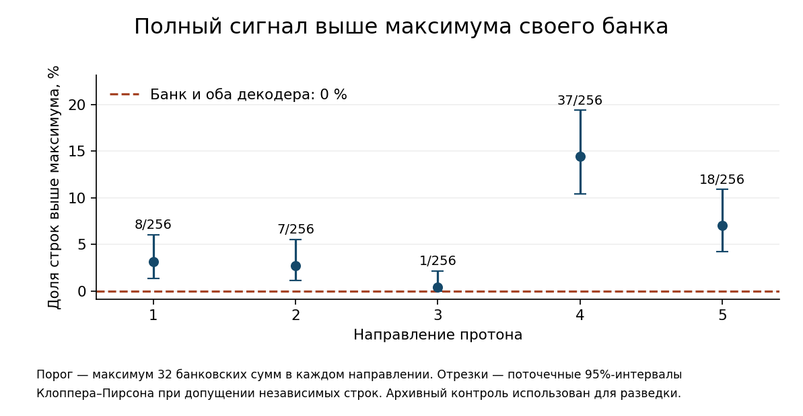

# Рецензия 1. Хвосты энерговыделения в FHCal GMM

23 ноября 2026 года. База ревизии — `fc283de`. Предмет проверки — [план экспериментов](tail_experiment_plan.md) и разведочный пересчёт сохранённого протонного генератора. Роли, тяжесть замечаний и правила принятия решения соответствуют §30.8 thesis-kb и проектному брифу FHCal. Четыре научных критика работали независимо в режиме чтения; отдельно проведены проверка готовности запуска, аудит чисел и рецензирование готового атласа.

**Решение.** Допустить абляцию полной энергии и парную проверку формы при известной сумме. Для использования текущего банка в отборе выше его максимума — отказ. Для оценки предела пространственной GMM требуется сравнение при общей модели энергии, прямой секционный контроль и свежая симуляция. Нейросетевые модели в этом пересчёте не обучались.



В направлении 4 максимальный банковский отклик равен 34,12479 в единицах экспорта, максимальный отклик сравниваемой симуляции — 54,58091. Для 37/256 превышений поточечный точный 95%-интервал составляет 10,38–19,37 % при условии независимости строк. Направление с крупнейшим расхождением выбрано после просмотра. Интервал иллюстрирует точность оценки для отдельного среза. Атлас содержит исходные распределения для всех направлений.

## Замечания и принятые решения

| Роль / статус | Свидетельство и возражение | Исправление или следующая проверка | Вердикт рецензента |
|---|---|---|---|
| T1, технический [B] | Генератор выбирает целую пару параметров и суммы, 32 значения на направление. Многократное декодирование оставляет поддержку суммы прежней. | Пересчитаны строгие превышения банковского максимума по секционным суммам; в плане отдельно проверяется непрерывная модель полной энергии. | Да для диагностики; нет для подтверждения хвостов. |
| M1, методологический [B] | В 23 из 270 пар «модуль × направление» контроль содержит ноль положительных строк. Пять направлений дают неоднородные законы энергии. Пространственная аппроксимация и генерация суммы смешивались в интерпретации. | Публиковать число попаданий; разделить проверку при наблюдаемой сумме и свободную генерацию. Ввести тест мощности, совместный отбор, семейные интервалы и исход «неопределённо». | Да для разведки, нет для физического допуска на этом контроле. |
| X1, текст [B] | Близкие средние занятости скрывали расхождение положительного q90 модуля 26 уже между исходным банком и референсом. В старом графике суммы диапазон заканчивался на объединённом q99,5. | Первая таблица плана показывает хвост по пяти условиям, рисунки доходят до максимума, подписи различают банковские строки и повторные розыгрыши. | Да для диагностического плана. |
| Управление / критический путь [S] | При известном ограничении суммы обучение четырёх сетей до проверки формы расходует бюджет без локализации причины. Архивный FM иллюстрировал один мюонный модуль, цикл WGAN требует проверки на целевой протонной задаче. | Сначала reference–reference и известная сумма; затем прямая и латентная cFM, после них пара WGAN-GP. Развести цену подгонки кодов, обучения и инференса. | Да для поэтапного сравнения, нет для отказа от всего класса. |
| Предстартовая проверка [B для подтверждающего теста] | В NPZ отсутствуют исходные event ID, уже использован старый контроль. Семь первых слоёв суммируют 54 модуля, последние три — 20. | Подтверждены хеши источника/банка, индексы среза, карта, сохранение суммы по двум проекциям. Зарезервировать независимые партии и пороги до финального запуска. | GO для исторического пересчёта; NO-GO для сертификации. |
| Численный аудит | По старой сетке порог 34,13943 даёт 36/256 превышений; точный максимум банка 34,12479 даёт 37/256. Расхождение объясняется выбором порога. | Отчёт использует точный максимум. Число превышений не меняется при сдвиге на 0,00001. q90 и число положительных проверены по каноническому энергетическому экспорту. | Да для приведённых чисел и знаменателей. |
| Рецензирование рисунков [S] | Проверены реальные страницы для направлений 3 и 4, 55 страниц, 1 300 записей CSV. В первом рендере левая ось десяти слабосигнальных панелей выходила за объявленный диапазон. | Для положительного максимума выставлена фактическая шкала. В подписи указано, почему кривые трёх банковских вариантов для полной энергии совпадают. | GO для разведочного атласа; проверены исправленная страница 24 и итоговый рисунок полной энергии. |

[B] блокирует соответствующий физический вывод; [S] уточняет дизайн или представление. Последний прежний результат интегрирования по массовой глубине датирован 20 ноября. 21 ноября прототип выделен в самостоятельный репозиторий. 23 ноября повторно рассчитаны распределения и границы поддержки; это новый диагностический результат на историческом контроле. Новый кластерный запуск для него не требовался.

**Цена следующего решения.** В архивных замерах интегральная подгонка одной строки при K=6 и K=8 занимала в среднем около 0,84 и 1,37 с на одном направлении. При таком темпе 10 000 строк потребуют около 2,3 и 3,8 однопоточных часа соответственно без учёта ввода и вывода. Перемерить на стратифицированном пилоте допустимо до расширения банка. Срок для cFM и WGAN-GP определяется после замера одной эпохи и цены генерации в целевых конфигурациях. Срок физической квалификации зависит также от независимой симуляции и допусков для отбора.

## Как воспроизвести атлас

Из корня репозитория подготовить **протонный** NPZ по [инструкции](../PIPELINE.md), затем выполнить

```sh
OPENBLAS_NUM_THREADS=1 VECLIB_MAXIMUM_THREADS=1 \
  python src/plot_tail_atlas.py data/fhcal_data_side_modules81619_180.npz reports/tails
```

Исходные индексы заданы полем `split[].holdout` в [калибровке](../src/gaussian_projection/proton_pilot/conditional_baseline/stochastic_decoder.json). Числа по каждому срезу доступны в [CSV](../reports/tails/proton_tail_counts.csv), контрольные суммы и точные пороги — в [JSON](../reports/tails/proton_total_support.json). Положительные квантили и долю нулей можно сверить с [экспортом предыдущего пилота](../src/gaussian_projection/energy_response.json). В CSV пустая ячейка q90 означает, что положительных попаданий нет. В тонких хвостах это существенно: очень малые положительные отклики гладкого численного декодера отличаются от точных нулей. Порог электроники требует отдельной калибровки.

[Атлас](../reports/tails/proton_tail_atlas.pdf) содержит по 11 страниц на направление: две страницы для полной суммы и слоёв, затем девять страниц для 54 модулей в порядке идентификаторов. Страницы 1, 12, 23, 34 и 45 начинают направления 1–5. Для каждой наблюдаемой слева показана эмпирическая функция распределения в основной области, справа — безусловная вероятность превышения до последнего наблюдения. При пороге, заданном заранее, отсутствие превышений требуется сопровождать верхним пределом. Положение максимума в атласе само по себе такого предела не задаёт.
