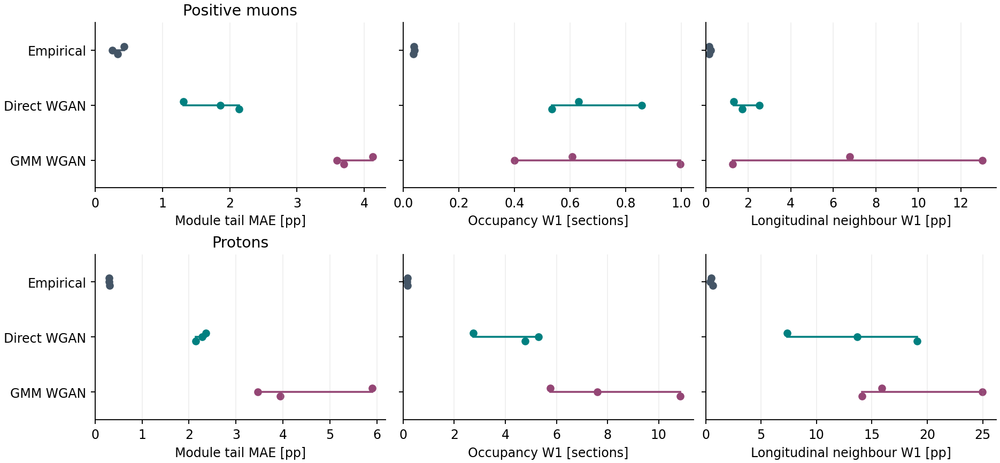

# Генерация пространственного отклика FHCal при известной сумме

На 12 288 новых мюонных и 20 480 новых протонных записях эмпирическая форма, выбранная при близкой сумме и том же направлении, точнее обеих обученных моделей воспроизвела модульные хвосты. При сравнении двух WGAN-GP прямой выход на 438 секций дал меньшую среднюю ошибку, чем интегрирование предсказанной гауссовской смеси. Суммарный сигнал каждой контрольной записи был известен всем методам.

## Частота превышения порога модуля

Порог q95 определён по положительным сигналам отдельной калибровочной выборки для каждой пары «модуль × направление». Частоту строгих превышений в контроле считаем **среди всех 4096 строк направления**, включая нулевые сигналы модуля. Для каждой пары берём абсолютную разность частот в модели и транспорте. Сначала усредняем ошибки по пригодным модулям каждого направления, затем поровну по направлениям. Включены 6 мюонных и 123 протонные пары с ≥500 положительными калибровочными сигналами. Эта оценка отличается от ранее опубликованной медианы условных частот среди положительных сигналов.

| Генерация пространственной формы | µ⁺, средняя ошибка [п.п.] | p, средняя ошибка [п.п.] |
|---|---:|---:|
| Эмпирическая форма одного из 16 соседей по log T | **0,34** (0,26–0,43) | **0,30** (0,30–0,31) |
| WGAN-GP, прямой выход на 438 секций | 1,77 (1,31–2,14) | 2,26 (2,14–2,36) |
| WGAN-GP, интегральная GMM | 3,80 (3,59–4,12) | 4,44 (3,47–5,90) |

В скобках минимум и максимум трёх запусков. У WGAN это три независимые инициализации обучения, у эмпирического метода — три розыгрыша из одной обучающей выборки. Разность «GMM минус прямой выход» положительна для всех трёх пар инициализаций у обоих видов. Средние разности равны +2,03 п.п. у мюонов и +2,18 п.п. у протонов. При парном бутстрепе контрольных строк внутри направления (400 повторов) процентильные 95%-интервалы равны [1,74; 2,22] и [2,14; 2,21] п.п. Модели, направления, калибровочные пороги и три реализации шума считаются фиксированными. Независимость архивных строк требует подтверждения идентификаторами первичных событий.

Направления различаются. В третьем мюонном направлении средняя по инициализациям ошибка GMM составила 1,67 п.п. против 2,89 п.п. у прямого выхода. В первых двух мюонных и во всех пяти протонных направлениях средняя ошибка ниже у прямого выхода. [Мюоны по направлениям](muon_directions.csv) · [протоны по направлениям](proton_directions.csv) · [модульные числители и знаменатели для µ⁺](muon_modules.csv) · [для p](proton_modules.csv).

## Число сработавших секций и продольное соседство

Для сравнения гладких карт выделяем секции с долей ≥1% полной суммы. Для каждой строки вычисляем их число и долю из них, имеющих хотя бы одного такого же соседа в предыдущем или следующем слое того же модуля. Сравниваем распределения с транспортной симуляцией по расстоянию Вассерштейна первого порядка W₁, затем усредняем поровну по направлениям и запускам.

| Генерация формы | µ⁺, W₁ числа секций | p, W₁ числа секций | µ⁺, W₁ соседства [п.п.] | p, W₁ соседства [п.п.] |
|---|---:|---:|---:|---:|
| Эмпирическая | 0,04 | 0,16 | 0,19 | 0,52 |
| WGAN-GP, прямой выход | 0,67 | 4,27 | 1,86 | 13,37 |
| WGAN-GP, GMM | 0,67 | 8,06 | 7,02 | 18,33 |



*Each point is one run. WGAN points use different training initializations. Empirical points use independent donor draws. Lower values indicate closer agreement with transport simulation. Occupancy and adjacency use sections carrying at least 1% of the total signal.*

В мюонном наборе модели почти одинаково воспроизводят распределение числа секций выше 1%, но расходятся по продольному соседству. Чувствительность к точным нулям значительно выше. Прямой softmax дал положительные значения во всех 438 секциях, тогда как в транспорте положительны в среднем 9,07 у мюонов и 25,45 у протонов. У гладкой GMM математический интеграл положителен в каждой чувствительной секции; точные нули в выходном массиве зависят от машинной точности. Ни одна из этих реализаций не моделирует физическую вероятность срабатывания секции отдельной переменной.

## Дизайн и границы вывода

- Для каждого направления использованы по 4096 прежних записей обучения и калибровки. Дополнительные 4096 контрольных строк исключают прежние индексы исследования и совпадения по паре «вершина, секционная карта» внутри того же направления. Все контрольные суммы положительны. Вид и направление заданы дискретно. В эксперименте нет интерполяции по импульсу, генерации T или полной реакции. [Протокол](PROTOCOL.md) · [новые индексы µ⁺](muon_reference.json) · [новые индексы p](proton_reference.json).
- Обе модели получают один и тот же стандартный гауссовский шум размерности 16, направление и стандартизованный log T. На каждом шаге критик получает 438 секционных долей и те же условия. В обеих сетях по два скрытых слоя шириной 96 с LeakyReLU. Для прямой модели выход — softmax над секциями. Для GMM задаются веса, центры и три ширины каждой из 4 (µ⁺) или 6 (p) компонент, затем вычисляются интегралы по чувствительным секциям с нормировкой каждой компоненты. Выходные суммы проверены для каждой реализации. Эмпирический метод использует только обучающие формы.
- Бюджет на одно обучение — 800 шагов генератора и 2400 шагов критика, размер батча 64, коэффициент градиентного штрафа 10. Число параметров генератора для µ⁺ составляет 53 814 у прямой модели и 14 044 у GMM, для p — 54 006 и 15 594. Прямая ветвь инициализируется логарифмом средней обучающей карты с малой добавкой, GMM — центрами по квантилям продольного профиля той же карты. Эти различия и фиксированный бюджет ограничивают вывод о представлениях.
- При проверке сохранения T в первой версии GMM обнаружено занижение нормировки для узких компонент за пределами чувствительных секций. В итоговом варианте вероятности прямоугольных ячеек и нормировка вычисляются в логарифмической шкале. После исправления повторены все шесть обучений GMM. Добавлен тест сравнения с независимой реализацией интеграла при узкой компоненте около разрыва геометрии.

На изученных направлениях эмпирическая форма остаётся более точной отправной точкой для условной генерации. Следующее сравнение — ввести одинаковый механизм срабатывания секций для обеих ветвей и проверить одновременно вероятность нуля, занятость и q95. Новую настройку следует подбирать на отдельной валидации. Для физического применения затем понадобится проверка с генерируемой суммой и независимыми транспортными событиями.

## Воспроизведение

Из корня FHCal_GMM, с зависимостями requirements-single-particle.txt и двумя распакованными архивами, указанными в PIPELINE.md:

```sh
python src/prepare_shape_comparison.py muon data/fhcal_data_muons_81619.npz
python src/prepare_shape_comparison.py proton data/fhcal_data_side_modules81619_180.npz
for species in muon proton; do
  for head in direct gmm; do
    python src/conditional_shape_wgan.py "$species" "$head"
  done
done
OPENBLAS_NUM_THREADS=1 MPLBACKEND=Agg python src/evaluate_conditional_shapes.py
```

Для повторной оценки с сохранёнными [параметрами моделей](models/) достаточно подготовить карты и выполнить последнюю команду. Отчёты отдельных обучений содержат число параметров, длительность и значения функций потерь. [Числа для таблиц и рисунка](summary.json).
