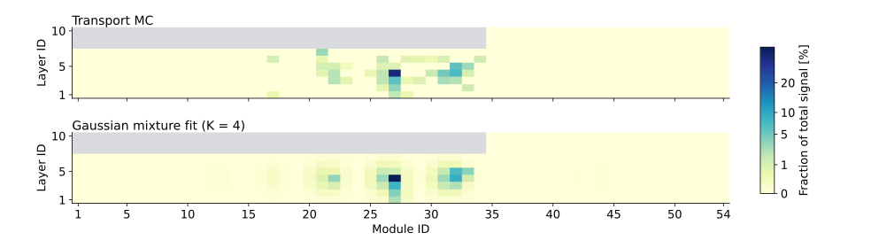
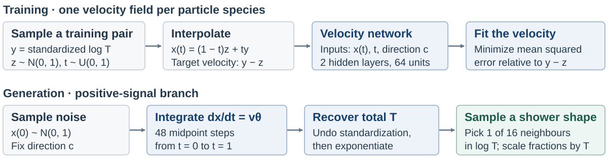
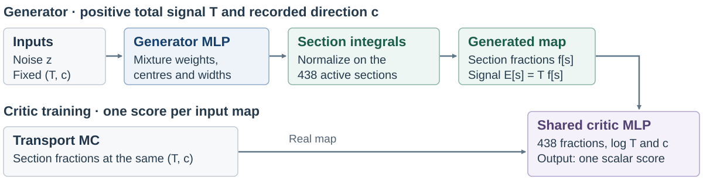
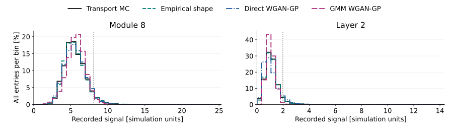
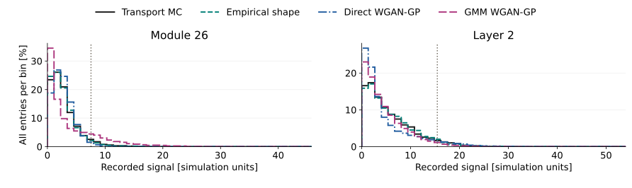
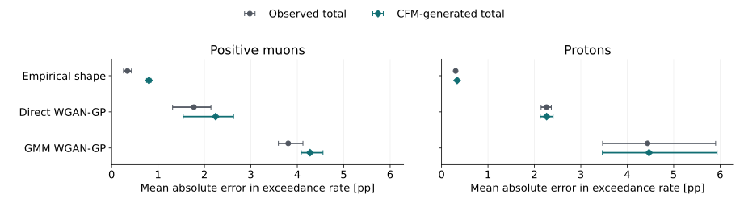
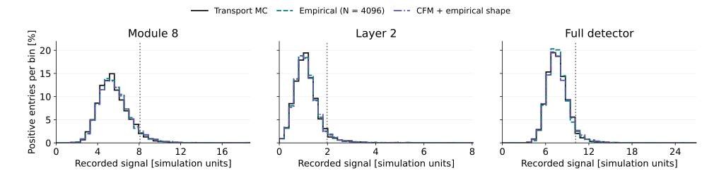
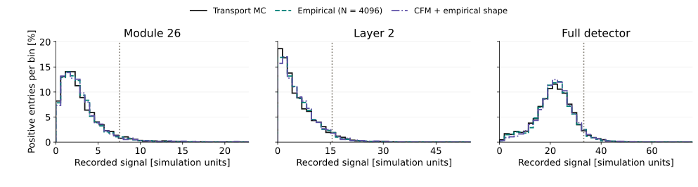

## WGAN-GP и flow matching для отклика FHCal

::: {.context}
BM@N · Калориметр FHCal · Мюоны и протоны · 24 ноября 2026
:::

Для одной частицы моделируем суммарный сигнал FHCal и его распределение по секциям. Порог q95 — 95-й процентиль положительных сигналов модуля на калибровочной выборке данного направления.

Сравниваем три способа распределить суммарный сигнал по секциям: карту из обучающей выборки, прямой генератор WGAN-GP и WGAN-GP с гауссовской смесью (GMM). Проверяем каждый способ с суммой из транспорта и с суммой из модели условного flow matching (CFM).

::: {.takeaway}
На новых контрольных записях прямой WGAN-GP точнее воспроизводит частоту превышения модульного порога q95 в среднем по направлениям, чем WGAN-GP с GMM. Наименьшую ошибку даёт эмпирическая форма.
:::

::: {.slide-footnotes}
4096 контрольных строк на направление · [Сумма из транспорта](../conditional_shapes/RESULTS.md) · [Сумма из CFM](../generated_total/RESULTS.md) · [Новые контрольные записи](../generated_total_replication/RESULTS.md)
:::

::: {.notes}
В парном опыте фиксируем наблюдаемую сумму каждой контрольной записи и её направление. Калибровочный порог определён отдельно для каждого модуля и направления по положительным сигналам. Частота превышения оценивается по всем строкам. Сравнение пространственных форм охватывает 6 мюонных и 123 протонные пары модуль × направление.
:::

## Результаты WGAN-GP на новых контрольных записях

::: {.context}
CFM задаёт всем моделям одинаковые суммарные сигналы. WGAN-GP распределяет сигнал по секциям напрямую или через параметры гауссовской смеси. Контроль включает по 4096 ранее не использованных записей на направление для мюонов в направлениях 1, 2, 3 и для протонов в направлениях 1, 3, 5.
:::

| Модель пространственного отклика | Мюоны, п.п. | Протоны, п.п. |
|:--|--:|--:|
| Прямой WGAN-GP | 1,98 | 2,30 |
| WGAN-GP с GMM | 4,11 | 4,59 |
| Эмпирическая форма (карта из обучающей выборки) | **0,61** | **0,33** |

В таблице средняя абсолютная ошибка частоты превышения модульного q95. У мюонов в направлении 3 ошибка меньше у WGAN-GP с GMM.

::: {.slide-footnotes}
Строки из тех же архивов · Протонные направления 2 и 4 оценены отдельно на 502 и 591 записи · [Отчёт и числа по направлениям](../generated_total_replication/RESULTS.md)
:::

::: {.notes}
Взяты другие строки тех же архивов. Из каждого направления исключены ранее использованные индексы и точные совпадения вершины и секционной карты. Независимость первичных событий требует проверки их идентификаторов. Пороги вычислены по положительным сигналам калибровочных модулей, частоты — по всем строкам направления. В расчёте по прежнему контролю на тех же трёх протонных направлениях ошибки равнялись 0,34, 2,31 и 4,61 п.п. Между двумя транспортными выборками среднее абсолютное расхождение частот равно 0,41 п.п. у мюонов и 0,25 п.п. у протонов. Прогнозы и калибровочные пороги при замене контрольных записей сохранены.
:::

## Пространственная смесь задаёт доли сигнала в 438 секциях

::: {.context}
Одна частица на входе → полный видимый сигнал T → распределение T по секциям
:::

| Величина | Физический смысл и роль в генераторе |
|:--|:--|
| Условия c | Вид частицы, энергия, направление импульса, координаты и время на входной поверхности FHCal. |
| Сумма T | Случайный видимый сигнал. Сначала разыгрываем индикатор нулевого отклика. При ненулевом отклике разыгрываем его величину. |
| Форма при T > 0 | K гауссовских компонент с весами, центрами и ширинами. Интеграл каждой по объёму секций даёт вероятности, нормированные на чувствительной геометрии. |
| Карта Eₛ | Доля секции s, умноженная на T. Суммы по секциям дают отклик каждого модуля, слоя и всего детектора. |

::: {.takeaway}
Гауссовская форма относится к пространству одного отклика. Асимметрия энергий одного модуля от события к событию — самостоятельная проверка генератора.
:::

::: {.slide-footnotes}
54 модуля · слои 1–7 охватывают 54 модуля, слои 8–10 — 20 · [Геометрия и проекция](../../docs/experiment_protocol.md)
:::

::: {.notes}
Базовая интегральная модель использует диагональные ковариации. Вариант с массовой глубиной интегрирует сигнал по активным пластинам и учитывает вклад плотного поглотителя в пройденную поверхностную плотность. В сравнении вариантов интегрирования по пластинам изменение W₁ продольного соседства составило −0,39 п.п. с 95%-интервалом [−0,93; +0,22]. Для физической интерпретации нужна сверка укладки с геометрией ROOT.
:::

## У протонов число компонент важно при высокой заполненности

::: {.context}
Proton response with 39 active sections, the highest occupancy among 96 records at this direction. Both maps use the same total signal. Grey cells are outside the instrumented geometry.
:::

::: {.figure}
{alt="Section signal fractions for one proton and a four-component Gaussian mixture fit. Grey cells are outside the instrumented geometry."}
:::

На примере с K = 4 расстояние полной вариации TV = 0,214. По всем 96 строкам увеличение K с 4 до 8 снижает среднюю TV с **0,142 до 0,057**. При K = 8 для 10 строк с ≥31 сработавшей секцией средняя TV остаётся **0,131**.

::: {.slide-footnotes}
TV = ½ суммы абсолютных разностей секционных долей · лучше ближе к нулю · серый — вне геометрии · [Протонный пилот](../../src/gaussian_projection/proton_pilot/RESULTS.md)
:::

::: {.notes}
Строка 125928, прямоугольная сетка индексов модуль × слой, общий нелинейный цветовой масштаб, подписанный в процентах. Конечное решение K=4 для примера достигло лимита итераций и включено. Для остальных 86 строк при K=8 средняя TV равна 0,0480. На отдельной мюонной выборке из 96 строк ослабление нижней границы ширин при K=4 снизило среднюю TV с 0,2154 до 0,0093. Подгонка использует секции той же строки. Значение TV характеризует представимость карты и не оценивает генерацию по условиям.
:::

## Мультиномиальное распределение сигнала по секциям сохраняет его сумму

::: {.context}
При заданном направлении равновероятно выбираем исходную запись и используем её сумму T и параметры пространственной смеси.
:::

| Этап | Одна реализация отклика |
|:--|:--|
| 1. Выбрать запись | На каждое направление приходится 128 мюонных записей со смесями из K = 4 компонент или 32 протонные записи с K = 6. |
| 2. Интегрировать | Для каждой компоненты k вычислить вероятности секций pₖₛ. Гладкий декодер отдаёт секции s долю Σₖ wₖ pₖₛ. |
| 3. Разыграть секции | Для каждой компоненты независимо распределить L = 128 порций по секциям с вероятностями pₖₛ. При nₖₛ попаданиях сигнал Eₛ = T Σₖ wₖ nₖₛ / L. |

::: {.takeaway}
При повторной генерации для каждой секции средний сигнал равен предсказанию гладкой смеси. Сумма по секциям в каждой реализации точно равна T исходной записи.
:::

::: {.slide-footnotes}
Число порций откалибровано на протонах и перенесено на µ⁺ · [Проверка декодера](../../src/gaussian_projection/proton_pilot/conditional_baseline/DECODER_ANALYSIS.md)
:::

::: {.notes}
Каждое из L попаданий компоненты вносит сигнал T·wₖ/L. Это параметр дискретизации. Для каждой исходной записи получено 16 реализаций у мюонов и 32 у протонов. Критерий сходимости выполнен для 307/384 мюонных и 149/160 протонных подгонок. Конечные решения при достижении лимита итераций также включены.
:::

## Условный flow matching моделирует суммарный сигнал

::: {.context}
Training and sampling for one particle species. The condition c identifies the recorded momentum direction.
:::

::: {.figure .architecture}
{alt="Training fits the velocity along a straight path from noise to standardized log total signal. Generation integrates the field, recovers the total and scales an empirical shower shape."}
:::

Вероятность T = 0 оцениваем по обучающим записям данного направления. При T > 0 сеть генерирует только сумму. Доли сигнала по модулям и слоям берём из одной записи того же направления.

::: {.slide-footnotes}
8192 розыгрыша на направление · в пилоте форма эмпирическая · [Реализация CFM](../../src/conditional_tail_flow.py)
:::

::: {.notes}
В обучении при линейном пути x(t) = (1−t)z + t·y целевая скорость равна y−z. После обратной стандартизации применяем экспоненту. Один двухслойный MLP с 64 скрытыми единицами на слой, 1800 обновлений, 48 шагов интегратора средней точки. Сохраняются 65 проекций: 1 сумма, 10 слоёв и 54 модуля. Пространственные параметры GMM обученная здесь сеть не предсказывает. Для следующего опыта потребуется определить единый порядок компонент или учесть их перестановочную симметрию.
:::

## План сравнения GMM и прямой генерации секционных сигналов

::: {.context}
WGAN-GP обучены при заданной сумме T и направлении c. Обучение CFM для пространственной формы запланировано.
:::

| | Пространственная GMM | Прямая генерация секций |
|:--|:--|:--|
| Flow matching | Поле скорости для весов, центров и ширин смеси | Поле скорости для формы карты из 438 секций |
| WGAN с градиентным штрафом | Генератор из шума, T и c выдаёт параметры смеси. Дифференцируемый интеграл переводит их в секции | Генератор из тех же входов выдаёт неотрицательные доли на маске секций |

При обучении CFM целевыми величинами служат параметры подогнанной смеси или доли сигнала в секциях. У WGAN в обоих вариантах критик сравнивает секционные карты с картами транспортной симуляции.

::: {.takeaway}
Сравнение по столбцам проверяет ограничение формы, по строкам — способ обучения. Решение принимаем по хвостам, нулям и корреляциям на контроле.
:::

::: {.slide-footnotes}
Две ветви WGAN-GP проверены на новом контроле · 4096 обучающих записей на направление · [План сравнений](../../docs/tail_experiment_plan.md)
:::

::: {.notes}
Градиентный штраф накладывается на градиент оценки критика по интерполяциям реальной и сгенерированной карт при одинаковом условии. Генератор максимизирует среднюю оценку синтетической карты. Нужно согласовать шкалы сумм, геометрию, разбиения, бюджет параметров, число настроек и вычислений; повторить сравнение при независимых инициализациях. Критик может учитывать суммы по модулям и слоям. Непрерывный релаксированный декодер — отдельный вариант, если потребуется совместно обучать локализацию.
:::

## Условный WGAN-GP для генерации секционных сигналов

::: {.context}
Tested architecture. Real and generated maps share the same total signal T and recorded direction c.
:::

::: {.figure .architecture}
{alt="A conditional generator predicts Gaussian mixture parameters. Section integrals produce 438 signals. A shared critic scores these maps and transport simulation maps separately at the same total and recorded direction."}
:::

Критик максимизирует разность средних оценок транспортных и сгенерированных карт со штрафом за отклонение нормы градиента от единицы. Генератор повышает оценку своей карты, получая градиент через интегралы смеси.

::: {.slide-footnotes}
Три инициализации на каждую ветвь и вид частиц · [Обученный генератор](../../src/conditional_shape_wgan.py)
:::

::: {.notes}
Для шага обучения берём из транспортной выборки карту, её положительную сумму T и входные условия c. Генератор получает те же T и c и независимый шум. Можно задать веса смеси через softmax, а ширины через softplus. Интегралы компонент по чувствительным секциям нормируем для каждой компоненты и суммируем с её весом. Полученные 438 долей умножаем на T. Критик получает секционные доли карты со стандартизованным log T и направлением c. При фиксированных T и c берём случайную линейную интерполяцию двух карт. Штраф WGAN-GP ограничивает отклонение нормы градиента критика по интерполированной карте долей от единицы. При обновлении генератора параметры критика фиксируем. Для прямого варианта заменяем выход параметров смеси и интегрирование на выход нормированных неотрицательных секционных долей, сохраняя архитектуру критика. Для инференса T задаётся общей моделью суммарного сигнала, при нуле возвращается нулевая карта. В парном контроле суммарный сигнал зафиксирован по транспорту.
:::

## Результаты WGAN-GP при известной сумме

::: {.context}
Transport MC — контрольная транспортная симуляция: 12 288 записей µ⁺ и 20 480 записей p. Все методы получают её T и направление.
:::

| Генерация формы | µ⁺, ошибка частоты [п.п.] | p, ошибка частоты [п.п.] |
|:--|--:|--:|
| Empirical shape · карта одной из 16 ближайших записей по log T | **0,34** | **0,30** |
| Direct WGAN-GP · прямой выход на 438 секций | 1,77 | 2,26 |
| GMM WGAN-GP · интеграл смеси по секциям | 3,80 | 4,44 |

Порог q95 рассчитан по положительным сигналам модуля. Частота превышения учитывает все контрольные строки. Абсолютные ошибки усреднены по модулям внутри направления, затем по направлениям и трём запускам.

::: {.takeaway}
У протонов GMM также хуже воспроизводит продольное соседство секций с долей ≥1%: W₁ = 18,33 п.п. против 13,37 у прямого выхода и 0,52 у эмпирической формы.
:::

::: {.slide-footnotes}
6 мюонных и 123 протонные пары «модуль × направление» · [Числа и границы вывода](../conditional_shapes/RESULTS.md)
:::

::: {.notes}
Это отдельный эксперимент с наблюдаемой суммой и новыми контрольными записями. Для каждого направления заново выбраны 4096 строк. На мюонах GMM точнее прямой сети в третьем направлении, но в среднем ошибка выше при каждой паре инициализаций. Обе сети обучены 800 шагов генератора при одинаковом критике, число параметров генераторов различается. Эмпирический метод использует одну из 16 ближайших по log T обучающих записей. В предыдущем пилоте модульные вероятности в основном считались среди положительных сигналов, а сумма могла генерироваться. Точные нули обеих гладких моделей не соответствуют разреженности транспорта.
:::

## WGAN-GP при заданном T: мюонный спектр в модуле 8

::: {.context}
Positive muons, direction 2. All 4096 reference entries are included. Model histograms are averaged over three runs; the dotted line marks the calibration q95.
:::

::: {.figure}
{alt="Ordinary signal histograms for positive muons, comparing transport simulation, empirical shapes and the two conditional WGAN-GP generators in module 8 and layer 2."}
:::

В модуле 8 выше q95 лежат **5,05%** контрольных сигналов. В среднем прямой WGAN-GP даёт 4,60%, WGAN-GP с GMM — 3,34%, эмпирическая форма — 5,30%.

::: {.slide-footnotes}
Знаменатель — все записи направления · наблюдаемая сумма T одинакова у всех методов для каждой записи · [Число превышений по запускам](../conditional_shapes/muon_modules.csv)
:::

::: {.notes}
Частота на контроле — 207 из 4096. У прямой модели получены 148, 209 и 208 превышений, у GMM — 75, 87 и 249, у эмпирической формы — 225, 225 и 201. Три реализации WGAN обучены независимо. Эмпирическая форма использует три розыгрыша из одной обучающей выборки. Для каждой панели использованы общие 40 интервалов в единицах симуляции.
:::

## WGAN-GP при заданном T: протонный спектр в модуле 26

::: {.context}
Protons, direction 3. All 4096 reference entries are included. Model histograms are averaged over three runs; the dotted line marks the calibration q95.
:::

::: {.figure}
{alt="Ordinary signal histograms for protons, comparing transport simulation, empirical shapes and the two conditional WGAN-GP generators in module 26 and layer 2."}
:::

В модуле 26 порог q95 превысили **4,91%** контрольных сигналов. У прямого WGAN-GP средняя частота 1,43%, у WGAN-GP с GMM — 19,37%. Разброс GMM по трём обучениям велик: от 0 до 31,69%.

::: {.slide-footnotes}
Эмпирическая форма: 4,08% · в первом интервале учтены и нулевые сигналы · [Число превышений по запускам](../conditional_shapes/proton_modules.csv)
:::

::: {.notes}
Порог 7,555 определён по положительным калибровочным сигналам. Число превышений на контроле — 201 из 4096; у прямого WGAN — 69, 59 и 48; у GMM — 1298, 1082 и 0; у эмпирического метода — 179, 163 и 159. Размах относится к трём обучениям GMM. Далее тем же генераторам формы задаём независимые суммы CFM. В обоих опытах порог и контрольные транспортные карты общие.
:::

## Результаты WGAN-GP при сумме из CFM

::: {.context}
В каждом направлении три генератора формы получают одни и те же 4096 сумм из CFM. Сравниваем с прежними транспортными записями при том же калибровочном пороге.
:::

::: {.figure}
{alt="Module q95 exceedance error under observed and CFM-generated total signal. Points and ranges summarize three runs for each spatial model."}
:::

При сумме из CFM замена прямого выхода WGAN-GP на GMM увеличила среднюю ошибку на **2,03 п.п. у мюонов** и **2,21 п.п. у протонов**. У эмпирической формы ошибка при этом способе задания суммы составила 0,81 и 0,33 п.п.

::: {.slide-footnotes}
Points and bars show the mean and range over three runs. Rates include zero signals. · [Модульные частоты и интервалы](../generated_total/RESULTS.md)
:::

::: {.notes}
q95 задан по положительным калибровочным сигналам. Усреднение равновесное сначала по пригодным модулям внутри направления, затем по направлениям и запускам. Обучена одна CFM суммы на каждый вид. Для WGAN использованы три сохранённых обучения, для эмпирической формы — три розыгрыша. В бутстрепе 400 раз независимо пересэмплировали контрольные и сгенерированные строки внутри направления, сохраняя общие суммы у трёх моделей формы. При фиксированных обучениях и порогах 95%-интервалы для разности GMM минус прямой выход составили [1,73; 2,29] п.п. у мюонов и [2,16; 2,24] п.п. у протонов. Генерируемая карта и контрольная транспортная запись не связаны общим первичным событием.
:::

## Как отбор секций влияет на ошибки WGAN-GP

::: {.context}
При заданной сумме T берём число положительных секций k из обучающей карты близкой суммы и того же направления. Оставляем k наибольших сигналов WGAN-GP и восстанавливаем их сумму T.
:::

| Средняя абсолютная ошибка, п.п. | µ⁺ · до → после отбора | p · до → после отбора |
|:--|--:|--:|
| Частота срабатывания секции, прямой выход | 97,93 → 0,15 | 94,19 → 4,49 |
| Частота срабатывания секции, GMM | 37,08 → 0,35 | 77,87 → 4,81 |
| Частота превышения q95 модуля, прямой выход | 1,77 → 1,92 | 2,26 → 2,46 |
| Частота превышения q95 модуля, GMM | 3,80 → 4,06 | 4,44 → 4,47 |

Отбор секций уменьшил ошибку вероятности положительного отклика у обеих моделей. При этом во всех трёх запусках каждой модели у обоих видов частиц выросла ошибка модульного хвоста.

::: {.slide-footnotes}
Срабатывание секции означает сигнал > 0 в шкале симуляции · 4096 контрольных записей на направление · [Метрики по направлениям и запускам](../section_sparsity/RESULTS.md)
:::

::: {.notes}
Секционную частоту считаем по всем строкам направления и усредняем абсолютную ошибку по 438 секциям. Модульный q95 определён по положительным калибровочным сигналам. Число положительных секций задаёт эмпирический донор из 16 ближайших по log T обучающих записей. Пространственный выбор определяется ранжированием сигналов WGAN. Использован прежний контроль при наблюдаемом T. Для эмпирической формы средняя ошибка секционных частот составляет 0,03 п.п. у мюонов и 0,32 п.п. у протонов.
:::

## Как получены спектры положительных сигналов

::: {.context}
В отдельном сравнении с CFM берём контрольные записи прежнего пилота. Для каждой гистограммы отбираем положительные сигналы модуля, слоя или всего детектора.
:::

| Обозначение в легенде | Как получен сигнал |
|:--|:--|
| Transport MC | Эталон: 4096 отложенных записей транспортной симуляции на направление. Берём наблюдаемые сигналы секций. |
| Empirical (N = 4096) | Распределение по 4096 обучающим картам того же направления. Сумма и секционные доли взяты из одной записи. |
| CFM + empirical shape | Условный flow matching генерирует 8192 значения T на направление. Для каждого T выбираем одну из 16 ближайших по log T обучающих записей того же направления и умножаем её секционные доли на T. |

::: {.slide-footnotes}
Каждая линия нормирована по положительным сигналам своей выборки. Вертикальный пунктир — q95 положительных сигналов отдельной калибровочной выборки. [Выборки и модели](../single_particle/RESULTS.md)
:::

::: {.notes}
Обучение, калибровка порога и контроль используют три непересекающиеся выборки по 4096 транспортных записей на направление. Для CFM показаны 8192 генерации одной обученной модели на вид частиц. Каждая гистограмма нормирована на число положительных сигналов в данной проекции.
:::

## Мюоны, модуль 8. Частота превышения q95 у CFM выше контрольной

::: {.context}
Positive muons, direction 2. Histograms include positive signals only. The dotted line marks the calibration 95th percentile.
:::

::: {.figure}
{alt="Histograms of positive muon signals in module 8, layer 2 and the full detector."}
:::

В модуле 8 порог q95 превысили **4,81%** положительных контрольных сигналов (197/4096). На обучающей выборке частота составила 5,54% (227/4096), у CFM с эмпирической формой — 6,51% (533/8192).

::: {.slide-footnotes}
Доля положительных записей в каждом из 40 интервалов, % · модуль выбран по максимальной средней энергии на калибровке · [Все 54 модуля, 10 слоёв и сумма](../single_particle/muon_distributions.pdf)
:::

::: {.notes}
Порог равен 8,086 в единицах симуляции. При фиксированном пороге и независимости строк точный биномиальный 95%-интервал для контрольной частоты составляет 4,17–5,51%. Независимость первичных событий требует проверки по их идентификаторам.
:::

## Протоны, модуль 26. Порог q95 превышают 4,43% сигналов CFM

::: {.context}
Protons, direction 3. Histograms include positive signals only. The dotted line marks the calibration 95th percentile.
:::

::: {.figure}
{alt="Histograms of positive proton signals in module 26, layer 2 and the full detector."}
:::

В модуле 26 порог q95 превысили **4,72%** положительных контрольных сигналов (184/3900). На обучающей выборке частота составила 4,52% (177/3915), у CFM с эмпирической формой — 4,43% (351/7918).

::: {.slide-footnotes}
Доля положительных записей в каждом из 40 интервалов, % · модуль 26, слой 2 и сумма по детектору · [Атлас протонов](../single_particle/proton_distributions.pdf)
:::

::: {.notes}
Порог равен 7,555 в единицах симуляции. При фиксированном пороге и независимости строк точный биномиальный 95%-интервал для контрольной частоты составляет 4,07–5,43%. Знаменатели различаются из-за нулевых откликов модуля.
:::

## Ошибка частоты превышения q95 по модулям FHCal

::: {.context}
Абсолютная разность частот превышения q95 в модели и контрольной выборке, п.п. Учтены положительные сигналы. Для каждой модели показаны медиана и максимум по парам «модуль × направление».
:::

| Метод | µ⁺ · медиана / максимум | p · медиана / максимум |
|:--|--:|--:|
| Эмпирическая оценка (N₀) | 1,39 / 4,03 | 5,03 / 19,69 |
| Гладкая GMM (N₀) | 1,65 / 4,03 | 4,35 / 8,95 |
| GMM + мультиномиальный декодер (N₀) | 1,44 / 4,03 | 5,18 / 37,36 |
| Эмпирическая оценка (4096) | **0,42 / 0,73** | **0,52 / 2,91** |
| CFM + эмпирическая форма | 0,68 / 1,70 | 0,54 / 2,98 |

::: {.takeaway}
На 4096 обучающих записях на направление медианная ошибка эмпирической оценки у протонов равна 0,52 п.п. Для CFM с эмпирической формой она равна 0,54 п.п.
:::

::: {.slide-footnotes}
N₀ — число исходных записей на направление: 128 для µ⁺ и 32 для p. Сравниваются 6 мюонных и 123 протонные пары. Для эмпирической оценки по 32 записям и для GMM с мультиномиальным декодированием у протонов определены 122 значения. [Результаты](../single_particle/RESULTS.md)
:::

::: {.notes}
В исходных выборках порог превысили 1 из 128 положительных мюонных сигналов (модуль 8, направление 2) и 4 из 30 положительных протонных сигналов (модуль 26, направление 3, всего 32 записи). Повторное декодирование одной карты сохраняет её суммарный сигнал. Порог каждого модуля определён на независимой калибровочной выборке. При отсутствии положительных откликов у модели условная вероятность не определена. Учитываем отдельно долю нулей и безусловную частоту превышения. Оценки для CFM относятся к одному обучению на вид частицы.
:::

## Учёт направления уменьшает ошибку частоты превышения q95

::: {.context}
CFM с эмпирической формой · сравнение генерации при заданном направлении с равновероятной смесью предсказаний по всем направлениям того же вида частиц
:::

| Средняя абсолютная ошибка частоты превышения q95, п.п. ↓ | При заданном направлении | При смешении групп |
|:--|--:|--:|
| µ⁺ · 3 направления · 6 пригодных пар «модуль × направление» | **0,84** | 2,81 |
| p · 5 направлений · 123 пригодные пары | **0,31** | 3,03 |

Здесь знаменатель включает нулевые сигналы. Сначала усредняем ошибки по пригодным модулям группы, затем придаём одинаковый вес направлениям. В архиве вместе с направлением могут меняться вершины.

::: {.takeaway}
В отдельном протонном наборе добавление модуля импульса уменьшило ошибку прогноза медианы полной суммы с 5,90 до 3,24 ед. на 3046 строках. Для энергетического хвоста нужен скан с фиксированной точкой входа.
:::

::: {.slide-footnotes}
По одной реализации обучения · порог каждого модуля из положительной калибровки · [Направление](../single_particle/conditioning.json) · [Импульс](../single_particle/momentum_coverage.json)
:::

::: {.notes}
Результат по модулю импульса получен при сравнении двух регрессий градиентного бустинга с общими условиями направления и вершины. MAE на контроле, разность 2,66, парный 95%-интервал [2,52; 2,82]. Контрольная выборка содержит 3046 из 12184 строк с согласованной суммой. В сравнении групп изоляция направления и непрерывная интерполяция ещё не проверены. В целевом опыте замораживаем один порог для сравниваемых условий и сопоставляем знак и величину сдвига с симуляцией.
:::

## Для хвоста 1% нужно около 9500 положительных откликов на модуль и условие

::: {.context}
Планирование независимой контрольной партии для одного заранее фиксированного порога · цель — относительная полуширина 95%-интервала около 20%
:::

| Верхний хвост среди положительных | Положительных в контроле, ориентир | Первичных частиц при 10% положительных |
|:--|--:|--:|
| 5% (q95) | 1 825 | ≈18 250 |
| 1% (q99) | 9 508 | ≈95 080 |
| 0,1% (q99,9) | 95 944 | ≈959 440 |

**Охват пилота.** На калибровке для q95 требовалось ≥500 положительных строк, для q99 — ≥2500. Прошли 6/162 пар «модуль × направление» у µ⁺ для обоих порогов. У p прошли 123/270 для q95 и 39/270 для q99.

::: {.takeaway}
Сначала коротким прогоном измеряем f — долю входящих первичных с положительным откликом в данном модуле и условии. Заказ контрольных первичных частиц ≈ N₊ / f. Обучение и независимую калибровку планируем отдельно.
:::

::: {.slide-footnotes}
Биномиальный ориентир N₊ ≈ 1,96²(1−p)/(p·0,2²) · одно сравнение, независимые события · [Требования к статистике](../../docs/single_particle_protocol.md)
:::

::: {.notes}
Для p=0,001 точный результат приближённой формулы 95 943,96. В других строках числа округлены вверх. Критерии текущей пригодности относятся к калибровке и при равной статистике контроля означают около 25 ожидаемых превышений. Они значительно слабее целевой точности. Для решения о физической пригодности добавляем неопределённость калибровочных квантилей и учёт множественных сравнений. Мюонные модули с достаточной разведочной статистикой: направление 1 — 16 и 40, направление 2 — 3 и 8, направление 3 — 19 и 49.
:::

## Мюонный скан позволяет менять по одному входному параметру

::: {.context}
Одночастичный мюонный пучок · диапазоны энергии и углов задаёт распределение частиц на входной поверхности FHCal
:::

| Серия | Изменяем | Фиксируем и проверяем |
|:--|:--|:--|
| M0 · воспроизводимость | Независимые запуски транспорта | Один знак, энергия, нормальное падение в центр модуля. Длину пути определяем по траектории в транспортной симуляции. В модуле проверяем пик, нули и правый хвост. |
| M1 · энергия | ≥3 значений энергии | Фиксируем направление и точку входа. Один внутренний уровень оставляем целиком для проверки интерполяции. |
| M2 · направление | Сначала θ, затем φ при θ > 0 | Сохраняем энергию и фактическую точку входа. Сверяем профиль в глубину и перенос сигнала между модулями. |
| M3 · совместное условие | Энергия × направление, затем точка входа | Резервируем комбинацию внутри обучающей области. Отдельные серии в центре, у границы и у отверстия. |

::: {.takeaway}
При фиксированном пороге сравниваем изменение вероятности превышения в модели и транспортной симуляции. Для сравнения используем генерацию без учёта направления и эмпирическое распределение 4096 записей того же направления.
:::

::: {.slide-footnotes}
Архивный µ⁺, модуль 16, угол к +z 3,63° · на q95 симуляция 5,13% (210/4096), свёртка Ландау с Гауссом 5,02%, Гаусс 4,51% · [Мюонный контроль](../single_particle/RESULTS.md)
:::

::: {.notes}
В архивном M16 оба предсказания укладываются в точечный 95%-интервал симуляции [4,47; 5,85]%. Согласие одной хвостовой точки не выбирает распределение на всём диапазоне сигнала. Нормаль детектора и траекторию для M0 следует подтвердить геометрией и MC-треками. В M1 малое физическое изменение у проходящих мюонов допустимо; сначала оцениваем чувствительность контрольной выборки к такому изменению.
:::

## Рекомендуемые наборы для обучения и проверки

::: {.context}
Одночастичная симуляция · одна первичная частица на входе · отдельные партии для обучения, настройки порогов и финального контроля
:::

| Набор | Какие условия покрыть | Что требуется воспроизвести |
|:--|:--|:--|
| µ⁺, µ⁻ | Сначала M0–M3 по каждому нужному знаку | Прохождение, длина пути, асимметрия модульного сигнала |
| Протоны, π⁺, π⁻ | По каждому виду: энергия, угол, точка входа; центр и граница | Хвост адронного ливня, число сработавших секций, профиль по глубине |
| e⁻, e⁺ | Энергия и направление при фиксированной точке, затем край | Форма электромагнитного ливня, утечка, корреляции слоёв |
| Нейтроны | Энергия, направление, время входа и окно считывания | Нулевой отклик, вероятность регистрации, поздняя компонента |
| Ядра и фрагменты | Z, A и кинетическая энергия на нуклон; виды из потока | Редкие большие вклады, насыщение и вклад в хвост полной реакции |

::: {.takeaway}
Очередность после мюонов определяет вклад вида в хвост реальной реакции. Для каждого вида сначала оцениваем долю положительных откликов по модулям.
:::

::: {.slide-footnotes}
В проверенных одночастичных архивах присутствуют только PDG −13 (µ⁺) и 2212 (p) · [Заявка на новые симуляции](../../docs/single_particle_protocol.md)
:::

::: {.notes}
Новые сканы нужны также для протонов и µ⁺ с подтверждённой геометрией. Наборы пионов, электронов, нейтронов и ядер — рекомендации к подготовке, результатов по ним в этой работе нет. Для остальных существенно представленных видов используется та же программа. Отдельный набор полной реакции используется для закрытой проверки. Число первичных на точку рассчитывается по доле положительных откликов в наименее заполненных модулях, включённых в проверку и согласованной целевой точности с одновременным контролем нескольких каналов.
:::

## Один первичный трек должен быть связан со всем своим откликом

::: {.context}
Состав записи для обучения, независимой проверки и последующего сложения сигналов
:::

| Сохранять в датасете | Для какой проверки |
|:--|:--|
| ID запуска, события и первичного трека, связи треков с первичными частицами, начальное состояние генератора, вес, число входящих | Делить по независимым партиям и событиям; исключать общий первичный из разных ролей и считать вклад вторичных один раз. |
| PDG, Z/A, E и её определение, компоненты импульса, координаты и время пересечения | Восстановить условия на одной входной поверхности, включая частицы с нулевым сигналом. Указать систему координат и единицы. |
| Секционные вклады до оцифровки, время, маска, суммы, отклик после считывания | Проверить замыкание сумм и пустые события. Хранить геометрию, материалы, настройки транспорта, пороги, калибровку ADC/MIP и их версии. |

::: {.takeaway}
Выделяем независимые партии для обучения, подбора модели, калибровки q и закрытого теста. Пересечение архивов проверяем по идентификаторам и дубликатам до разделения.
:::

::: {.slide-footnotes}
В пилоте единица анализа — строка архива · ID и первичную множественность предстоит подтвердить по ROOT · [Спецификация экспорта](../../docs/single_particle_protocol.md)
:::

::: {.notes}
Малый и большой архивы частично совпадают по содержимому; имя файла не задаёт независимую выборку. Генерировать несколько стохастических реализаций одного кода допустимо для оценки шума декодера, но они не создают новых независимых транспортных событий.
:::

## Проверка полной реакции определит, пригодна ли GMM для физического анализа

::: {.context}
Общий список частиц на входе FHCal для быстрого и штатного транспорта · парное сравнение событий
:::

**Собрать событие.** Для каждой входящей частицы разыграть секционные вклады с учётом времени. Сложить их до нелинейного считывания. Затем один раз применить оцифровку, шум, насыщение, калибровку в MIP, триггер и отборы.

**Сравнить с экспериментом.** Для полной и быстрой симуляции использовать общие бины, отборы и данные. Проверить распределения всех модулей, слоёв и суммы, нули, q95/q99 и корреляции. Для анализа нужны численные спектры CCT, их неопределённости и ковариации.

::: {.takeaway}
Критерий «согласие не хуже штатной симуляции» задаём до теста. Для всех основных мер D одновременные верхние 95%-е границы разности D(быстрая, данные) − D(штатная, данные) должны быть ≤ 0. Хвосты быстрой симуляции также должны уложиться в заданные допуски к штатной.
:::

::: {.slide-footnotes}
Сначала замыкаем наложение истинных вкладов на штатном отклике · отдельно проверяем согласие быстрой и полной симуляции в хвостах · [Критерий и план полной реакции](../../docs/tail_experiment_plan.md)
:::

::: {.notes}
Для закрытой оценки нужны идентификаторы событий, транспортные пересечения, связь дочерних треков с первичным предком и вклады до общей электроники. Одна оцифровка предотвращает повторное добавление шума, порогов и насыщения. Закрытое сравнение использует физически одинаковые отборы. Заранее фиксируем меру, окна, семейство решающих каналов, учёт общей экспериментальной неопределённости и независимых партий. Если после замены закона суммы прямой генератор воспроизводит хвосты, а ошибка GMM превышает заданный допуск, исключаем смесь для такого режима. При недостаточной мощности исход остаётся неопределённым.
:::

## Выводы по мюонной и протонной выборкам

**Подгонка транспортной карты.** В среднем между секциями требуется перераспределить 0,93% сигнала у мюонов (4 компоненты GMM) и 5,66% у протонов (8 компонент).

**Генерация модульных хвостов.** Порядок моделей сохранился при замене транспортных записей. С суммой из CFM эмпирическая форма дала ошибку 0,61 п.п. у мюонов и 0,33 п.п. у протонов на трёх направлениях каждого вида. Средняя ошибка прямого WGAN-GP составила 1,98 и 2,30 п.п., а WGAN-GP с GMM — 4,11 и 4,59 п.п. соответственно.

**Положительные секции.** Отбор секций по величине сигнала улучшил частоту срабатывания отдельных секций, но увеличил ошибку модульных хвостов у обеих WGAN-GP.

::: {.takeaway}
CFM с эмпирической формой служит базой для следующего сравнения. У мюонов проверим верхний хвост суммарного сигнала. Для WGAN-GP следующий опыт — совместное обучение выбора секций и распределения сигнала между ними.
:::

::: {.slide-footnotes}
[Подгонки](../../docs/experiment_state.md) · [Наблюдаемая сумма](../conditional_shapes/RESULTS.md) · [Новые контрольные записи](../generated_total_replication/RESULTS.md) · [Выбор секций](../section_sparsity/RESULTS.md) · [План](../../docs/tail_experiment_plan.md)
:::

::: {.notes}
Доля перераспределяемого сигнала равна расстоянию полной вариации между секционными долями. Для мюонной подгонки использованы уменьшенные минимальные ширины компонент. Десять выделенных протонных карт имеют не менее 31 положительной секции. В отдельном опыте генераторы GMM использовали 4 компоненты у мюонов и 6 у протонов. Ошибки частоты превышения для прямого WGAN-GP равны 1,77 и 2,26 п.п., для WGAN-GP с GMM — 3,80 и 4,44 п.п. соответственно. Частота учитывает все контрольные строки, а q95 задан по положительным калибровочным сигналам для каждого модуля и направления. Проверены 3 мюонных и 5 протонных направлений, с 6 и 123 пригодными парами «модуль × направление». В третьем мюонном направлении средняя ошибка ниже у GMM. Полная реакция требует проверки наложения сигналов частиц и оцифровки. Проверка на одночастичных архивных строках ограничена зарегистрированными направлениями.
:::
