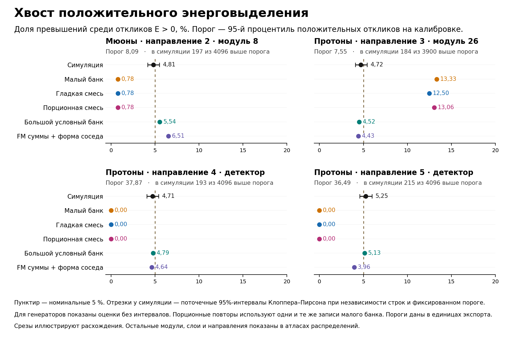

# Хвосты отклика FHCal на архивных мюонных и протонных строках

В протонных направлениях 4 и 5 ни одна запись малого банка не превышает калибровочный порог полной энергии. На новых контрольных строках симуляции выше порога оказались 4,71% и 5,25%. У мюонов направления 2 в наиболее энергонагруженном модуле 8 контроль даёт 4,81% превышений среди положительных откликов, а малый банк и оба его декодера — 0,78%. Независимый эмпирический банк из 4096 строк на направление даёт 5,54%. Эти расхождения возникают уже при выборе банковской записи. Отдельные модули дополнительно чувствительны к пространственному декодеру.

[Мюоны — все распределения](muon_distributions.pdf) · [Протоны — все распределения](proton_distributions.pdf) · [Числа для мюонов](muon_tails.csv) · [Числа для протонов](proton_tails.csv).

В атласах показана доля записей в каждом из 40 интервалов сигнала. Нулевые отклики входят в первый интервал. Для каждого распределения сумма частот равна 100%. Пунктир отмечает q95 положительных калибровочных сигналов.



## Выборки и модель

Записанные коды частиц — −13 (µ⁺) и 2212 (p). Условия задаются тремя точными векторами импульса мюонов и пятью векторами протонов. На каждое направление выделены непересекающиеся группы по 4096 строк для обучения, определения порогов и сравнения. Предыдущие диагностические строки исключены. Внутри каждого направления при подготовке удалены точные дубликаты по вершине и секционному отклику. Исходные событийные ID и первичную множественность необходимо подтвердить по симуляции. Единица текущей оценки — строка архива, сигнал выражен в единицах экспорта.

**Малый банк** выбирает исходный отклик среди 128 строк на направление для мюонов или 32 для протонов. На тех же строках рассмотрены гладкая пространственная GMM и стохастический декодер с 128 порциями на компоненту. **Большой банк** перебирает 4096 исходных обучающих строк этого направления. **Flow + форма** моделирует логарифм положительного полного сигнала при дискретном направлении и выбирает нормированную форму исходного отклика среди 16 ближайших обучающих строк по логарифму суммы. Для каждого вида обучена одна модель с одним seed и сгенерировано 8192 отклика на направление. Параметры пространственной GMM этим flow не предсказываются. Настройка 128 порций перенесена с протонов на мюоны без отдельной мюонной калибровки. Этот контроль проверяет совместимость непрерывной суммы с эмпирической формой на проекциях по модулям и слоям.

Мюонные смеси имеют 4 компоненты. При трёх стартах и лимите 200 итераций успешный статус получили 95/128, 102/128 и 110/128 выбранных подгонок по направлениям. Остальные 33, 26 и 18 достигли лимита. Для протонов при 6 компонентах, трёх стартах и лимите 800 успешны 31/32, 30/32, 29/32, 28/32 и 31/32. Все конечные решения включены в оценку. На каждый код разыграны 16 откликов у мюонов и 32 у протонов; повторы разделяют исходную сумму.

## Как читать превышения

Для каждой пары «направление, наблюдаемая» порог t равен q95 положительных сигналов отдельной калибровочной выборки. Для k строгих превышений среди n строк и n₊ положительных величин показываем k/n₊ и k/n. Если n₊ = 0, условная доля не определена (н/о). При отсутствии положительных калибровочных строк не определён и порог. Порог считается пригодным для основной диагностики при n₊ ≥ 500 на калибровке. Этот фильтр не гарантирует статистику события у сравниваемой модели.

## Охват по направлениям

| Частица | Напр. | Модули с ≥500 положительными строками на калибровке | Слои |
| --- | --- | --- | --- |
| µ⁺ | 1 | 16, 40 | 1–10 |
| µ⁺ | 2 | 3, 8 | 1–7 |
| µ⁺ | 3 | 19, 49 | 1–10 |
| p | 1 | 5, 8, 9, 10, 13, 14, 15, 17, 18, 19, 22, 23, 24, 28, 29, 34, 45, 46, 47, 48, 49, 50, 51, 52, 53, 54 | 1–10 |
| p | 2 | 5, 8, 9, 10, 13, 14, 15, 17, 18, 19, 22, 23, 24, 27, 28, 29, 34, 45, 46, 47, 48, 49, 50, 51, 52, 53, 54 | 1–10 |
| p | 3 | 13, 16, 17, 18, 20, 21, 22, 23, 24, 25, 26, 27, 28, 29, 30, 31, 32, 33, 34 | 1–7 |
| p | 4 | 1, 6, 7, 8, 11, 12, 13, 14, 16, 17, 18, 20, 21, 22, 23, 25, 26, 27, 30, 35, 36, 37, 38, 39, 40, 41, 42, 43, 44 | 1–10 |
| p | 5 | 6, 7, 11, 12, 13, 16, 17, 20, 21, 22, 25, 26, 35, 36, 37, 38, 39, 40, 41, 42, 43, 44 | 1–10 |

Полная энергия прошла фильтр во всех восьми направлениях. Из пар «направление, модуль» его прошли 6/162 у мюонов и 123/270 у протонов; из пар «направление, слой» — 27/30 и 47/50. PDF показывают по 54 модуля, 10 слоёв и полной энергии в каждом направлении, включая редкие и пустые каналы. В слоях 1–7 суммируются 54 модуля, в слоях 8–10 — 20.

## Модульные хвосты

Для каждого мюонного направления выбран модуль с наибольшей средней энергией по всем строкам калибровки, включая нули. Протонный M26 направления 3 был выделен ещё в предыдущем пилоте. Дополнительно показан протонный M29 как наибольшее наблюдаемое расхождение порционного декодера среди пригодных модулей. Порог t указан в единицах экспорта.

Доля превышений среди положительных сигналов k/n₊, %. В скобках для референса — индивидуальный 95%-й интервал Клоппера–Пирсона при фиксированном пороге и допущении независимости строк.

| Канал | t | Референс, 95% ДИ | Малый банк | Гладкий GMM | Порции GMM | Большой банк | Flow + форма |
| --- | --- | --- | --- | --- | --- | --- | --- |
| µ⁺ D1 M16 | 9,755 | 5,13 (4,47–5,85) | 7,81 | 7,03 | 6,79 | 5,62 | 6,59 |
| µ⁺ D2 M8 | 8,086 | 4,81 (4,17–5,51) | 0,78 | 0,78 | 0,78 | 5,54 | 6,51 |
| µ⁺ D3 M19 | 9,846 | 4,59 (3,97–5,28) | 4,69 | 4,69 | 4,69 | 4,93 | 5,54 |
| p D3 M26 | 7,555 | 4,72 (4,07–5,43) | 13,33 | 12,50 | 13,06 | 4,52 | 4,43 |
| p D3 M29 | 1,479 | 5,60 (4,30–7,15) | 25,00 | 6,25 | 42,95 | 4,41 | 4,48 |

Число положительных строк n₊/n по тем же каналам. Для порционного декодера и flow знаменатель включает все розыгрыши.

| Канал | Референс | Малый банк | Гладкий GMM | Порции GMM | Большой банк | Flow + форма |
| --- | --- | --- | --- | --- | --- | --- |
| µ⁺ D1 M16 | 4096/4096 | 128/128 | 128/128 | 2048/2048 | 4096/4096 | 8192/8192 |
| µ⁺ D2 M8 | 4096/4096 | 128/128 | 128/128 | 2048/2048 | 4096/4096 | 8192/8192 |
| µ⁺ D3 M19 | 4096/4096 | 128/128 | 128/128 | 2048/2048 | 4096/4096 | 8192/8192 |
| p D3 M26 | 3900/4096 | 30/32 | 32/32 | 980/1024 | 3915/4096 | 7918/8192 |
| p D3 M29 | 1072/4096 | 8/32 | 32/32 | 149/1024 | 1089/4096 | 2230/8192 |

Доля превышений среди всех строк k/n, %.

| Канал | Референс | Малый банк | Гладкий GMM | Порции GMM | Большой банк | Flow + форма |
| --- | --- | --- | --- | --- | --- | --- |
| µ⁺ D1 M16 | 5,13 | 7,81 | 7,03 | 6,79 | 5,62 | 6,59 |
| µ⁺ D2 M8 | 4,81 | 0,78 | 0,78 | 0,78 | 5,54 | 6,51 |
| µ⁺ D3 M19 | 4,59 | 4,69 | 4,69 | 4,69 | 4,93 | 5,54 |
| p D3 M26 | 4,49 | 12,50 | 12,50 | 12,50 | 4,32 | 4,28 |
| p D3 M29 | 1,46 | 6,25 | 6,25 | 6,25 | 1,17 | 1,22 |

В протонном M29 направления 3 порционный декодер дал 64 превышения среди 149 положительных розыгрышей (42,95%), референс — 60 среди 1072 (5,60%). При учёте всех строк соответствующие доли составляют 6,25% и 1,46%. В протонном M46 направления 2 калибровка содержит 599 положительных строк. Исходный малый банк и порционный декодер не дали ни одного положительного сигнала в этом модуле. Здесь k/n равно нулю, k/n₊ не определено.

## Продольные слои

Наибольшая ошибка условной вероятности порционного декодера среди пригодных слоёв пришлась на девятый слой у обоих видов частиц. Срезы выбраны по наблюдаемому расхождению. Числа в таблице — k/n₊, в скобках доля в процентах. В этом слое суммируются 20 геометрически присутствующих модулей.

| Частица и направление | t | Референс | Малый банк | Гладкий GMM | Порции GMM | Большой банк | Flow + форма |
| --- | --- | --- | --- | --- | --- | --- | --- |
| µ⁺ D3 | 1,876 | 117/2661 (4,40) | 6/90 (6,67) | 8/128 (6,25) | 145/1443 (10,05) | 116/2627 (4,42) | 263/5401 (4,87) |
| p D2 | 3,953 | 35/685 (5,11) | 1/4 (25,00) | 1/32 (3,12) | 32/64 (50,00) | 49/733 (6,68) | 96/1487 (6,46) |

Для протонов D2 безусловная частота превышений у порционного декодера равна 32/1024 (3,12%), а в симуляции — 35/4096 (0,85%). В исходном малом банке положительный сигнал в данном слое есть лишь у четырёх записей.

## Хвост полной энергии

У всех строк и розыгрышей в таблице полная энергия положительна. Для референса n₊/n = 4096/4096 по направлению. Проценты одновременно равны k/n₊ и k/n. У малого банка и двух его декодеров доли совпадают, поскольку интегрирование и розыгрыш порций сохраняют выбранную сумму.

| Направление | t | k/n референса | Референс, % | Малый банк, % | Гладкий GMM, % | Порции GMM, % | Большой банк, % | Flow + форма, % |
| --- | --- | --- | --- | --- | --- | --- | --- | --- |
| µ⁺ D1 | 13,806 | 218/4096 | 5,32 | 6,25 | 6,25 | 6,25 | 5,44 | 6,63 |
| µ⁺ D2 | 10,168 | 195/4096 | 4,76 | 2,34 | 2,34 | 2,34 | 5,13 | 6,37 |
| µ⁺ D3 | 12,951 | 197/4096 | 4,81 | 4,69 | 4,69 | 4,69 | 4,64 | 6,92 |
| p D1 | 37,799 | 195/4096 | 4,76 | 9,38 | 9,38 | 9,38 | 5,32 | 3,96 |
| p D2 | 37,729 | 189/4096 | 4,61 | 6,25 | 6,25 | 6,25 | 5,13 | 4,00 |
| p D3 | 33,163 | 209/4096 | 5,10 | 3,12 | 3,12 | 3,12 | 4,66 | 5,46 |
| p D4 | 37,871 | 193/4096 | 4,71 | 0,00 | 0,00 | 0,00 | 4,79 | 4,64 |
| p D5 | 36,489 | 215/4096 | 5,25 | 0,00 | 0,00 | 0,00 | 5,13 | 3,96 |

## Ошибка хвоста по всем пригодным каналам

Каждая пара «направление, наблюдаемая» получает одинаковый вес. Для каждой вычислена абсолютная разность вероятностей модели и симуляции в процентных пунктах. Сводка «все» включает полную энергию, слои и модули (36 пар у мюонов, 175 у протонов). В колонках «модули» включены только модульные распределения (6 и 123 пары). Значения в ячейках — медиана / максимум. Пустое значение k/n₊ в исходном CSV исключает пару из условного сравнения и сохраняет её в безусловном сравнении при известном пороге.

| Частица | Метод | Все, k/n₊ | Все, k/n | Модули, k/n₊ | Модули, k/n |
| --- | --- | --- | --- | --- | --- |
| µ⁺ | Малый банк | 1,36 / 4,81 | 1,37 / 4,83 | 1,39 / 4,03 | 1,38 / 4,03 |
| µ⁺ | Гладкий GMM | 1,32 / 4,33 | 1,28 / 4,35 | 1,65 / 4,03 | 1,38 / 4,03 |
| µ⁺ | Порции GMM | 1,58 / 5,65 | 1,44 / 4,83 | 1,44 / 4,03 | 1,38 / 4,03 |
| µ⁺ | Большой банк | 0,33 / 0,89 | 0,34 / 0,90 | 0,42 / 0,73 | 0,40 / 0,73 |
| µ⁺ | Flow + форма | 0,52 / 2,11 | 0,51 / 2,11 | 0,68 / 1,70 | 0,70 / 1,70 |
| µ⁺ | Объединённый банк | 0,44 / 29,61 | 0,59 / 29,61 | 0,42 / 0,73 | 3,01 / 3,34 |
| p | Малый банк | 4,84 / 29,18 | 1,68 / 8,98 | 5,03 / 19,69 | 1,61 / 8,01 |
| p | Гладкий GMM | 3,86 / 13,94 | 1,68 / 15,23 | 4,35 / 8,95 | 1,61 / 8,54 |
| p | Порции GMM | 5,04 / 44,89 | 1,71 / 11,72 | 5,18 / 37,36 | 1,61 / 8,01 |
| p | Большой банк | 0,50 / 2,91 | 0,22 / 1,05 | 0,52 / 2,91 | 0,22 / 1,05 |
| p | Flow + форма | 0,54 / 2,98 | 0,23 / 1,29 | 0,54 / 2,98 | 0,22 / 1,22 |
| p | Объединённый банк | 0,81 / 76,48 | 0,95 / 36,11 | 1,08 / 76,48 | 1,84 / 36,11 |

У протонов для исходного малого банка и порционного декодера условные сводки охватывают 174/175 пригодных наблюдаемых и 122/123 пригодных модулей. Остальные строки таблицы используют все пригодные пары. Объединённый банк — эмпирический контроль, в котором обучающие направления смешаны с одинаковым весом.

## Вывод и границы проверки

На этой проверке малый банк пропускает наблюдаемые хвосты полной энергии даже без пространственной аппроксимации. Декодер вносит дополнительную ошибку в отдельных модулях. Большой условный эмпирический банк и flow с эмпирической формой снижают типичную ошибку протонного модульного хвоста. По мюонным полным энергиям flow завышает частоты превышения во всех трёх направлениях. Обучение flow-компоненты само по себе ещё не подтверждает эквивалентность хвостов.

Основная проверка относится к q95 положительных сигналов, выбранным дискретным направлениям и одному обучению. Каждому направлению соответствует сочетание записанных условий. Причинный эффект отдельного параметра требует контрольных симуляций. Бутстреп по строкам или биномиальный интервал требует независимых исходных событий. Интервалы в CSV условны на фиксированном пороге и относятся к каждой отдельной референсной кривой. Межканальная множественность, неопределённость порогов, подбор малых банков и вариации при повторном обучении в этих интервалах не учтены. Для допуска в физический анализ требуется независимая проверка в его фазовом пространстве с заранее согласованными допусками.

Числа проверены пересчётом порогов, положительных наблюдений и превышений для всех 3640 строк двух CSV из сохранённых проекций и повторного розыгрыша из обоих чекпойнтов. Для каждой проекции проверено совпадение полного сигнала с суммой по модулям и со суммой по слоям. [Разбиение для мюонов](muon_split.json) · [разбиение для протонов](proton_split.json) · [параметры мюонного flow](muon_flow.json) · [параметры протонного flow](proton_flow.json).

## Более редкий хвост

Дополнительно проверили q99 на тех же контрольных строках. Порог ставится по положительным значениям отдельной калибровки. Для этой разведочной проверки потребовали не менее 2 500 положительных калибровочных строк, около 25 ожидаемых превышений при равном объёме и близком распределении. Этому условию соответствуют все шесть перечисленных мюонных пар «модуль × направление» и 39 протонных. Для q99,9 на таком же уровне разрешения потребовалось бы около 25 000 положительных строк на один срез. Текущий контроль содержит лишь 4 096 строк на направление.

| Протонное направление | Пригодные модули для q99 |
|---|---|
| 1 | 14, 15, 18, 19, 24, 47, 49, 51 |
| 2 | 14, 15, 18, 19, 24, 47, 49, 51 |
| 3 | 21, 22, 26, 27, 28, 31, 32 |
| 4 | 11, 12, 16, 17, 20, 21, 38, 40, 42 |
| 5 | 11, 16, 20, 38, 39, 40, 42 |

Среди положительных значений мюонного M8 направления 2 референс дал 39/4096 (0,95 %) превышений q99. В 2048 порционных реализациях не было ни одного превышения. Большой условный банк дал 0,81 %, гибридный flow — 1,28 %. В протонном M26 направления 3 референс дал 39/3900 (1,00 %), порционный декодер — 4,08 %, большой условный банк — 0,97 %, гибридный flow — 1,12 %. Эти значения относятся к выбранным реализациям моделей и порогам. [Мюоны, q99](muon_q99.csv) · [Протоны, q99](proton_q99.csv).

## Проверка направления и энергии

**Направление.** Для одного и того же обученного генератора сравнили правильное условие с равновероятной смесью его выходов по всем направлениям данного вида. Во втором варианте связь с направлением конкретной строки исчезает. Метрика — средняя абсолютная ошибка **безусловной** частоты превышения q95 по пригодным модулям внутри направления, затем среднее по направлениям. У мюонов ошибка составила 0,84 п.п. с условием и 2,81 п.п. при смешении, у протонов — 0,31 и 3,03 п.п. Среднее расстояние Вассерштейна по полной энергии составило соответственно 0,16 и 1,13 единицы у мюонов, 0,50 и 1,45 у протонов. Измерен эффект использования известных групп целым генератором, включая нормировку суммы и выбор формы. Несколько входных групп также различаются вершинами. Изолированный угловой эффект и интерполяцию проверит скан при одной точке входа. [Числа по направлениям](conditioning.json).

**Сдвиг на общем пороге.** Для мюонов фиксируем один порог всей суммы, 13,806, по калибровке направления 1. При переходе от направления 1 к 2 безусловная частота превышения в симуляции падает на 4,91 п.п. (218 → 17 из 4096), в гибридном генераторе — на 6,19 п.п. (543 → 36 из 8192). Модель воспроизводит знак сдвига. Разность эффектов равна −1,28 п.п.; консервативный 95%-интервал для этого контраста [−3,32; +0,75] п.п. получен из четырёх биномиальных границ с поправкой на четыре доли, условно на фиксированных модели и пороге. Это проверка записанных групп, при различающихся входных позициях геометрическая интерпретация требует контролируемой симуляции.

**Мюонный физический контроль.** Для M16, направление 1, t=9,755. Среди 4096 положительных референсных строк найдено 210 превышений (5,13 %, точечный 95%-интервал 4,47–5,85 %). Замороженная свёртка Ландау с Гауссом по ранее подогнанным параметрам даёт 5,02 %, замороженная гауссова форма — 4,51 %. Оба значения укладываются в этот интервал для одного порога. Угол к оси +z равен 3,63°. Нормальное падение и длину пути нужно подтвердить по транспортной истине.

**Модуль импульса.** В отдельном протонном файле с непрерывной кинематикой 12 184 строки имеют согласованные сумму секций и полный сигнал. На 9138 строках обучили две одинаково настроенные модели градиентного бустинга для условной медианы полной энергии, на 3046 проверили. Добавление |p| к направлению и вершине уменьшило среднюю абсолютную ошибку с 5,90 до 3,24 единицы экспорта. Парная разность — 2,66 с 95%-интервалом [2,52; 2,82] при фиксированных моделях и допущении независимости строк. Это показывает предсказательную ценность |p| для центрального отклика. Воспроизведение условного хвоста и физическую зависимость при одной и той же точке входа требуется проверять на управляемом энергетическом скане. [Покрытие, параметры обучения и численный результат](momentum_coverage.json).

## Данные и воспроизведение

Аудит восьми архивов исходной ревизии обнаружил только записанные PDG −13 и 2212. Все 359 997 уникальных строк малого мюонного файла входят в большой. После их исключения и дедупликации в большом остаются 323 996 уникальных записей. Все 180 000 строк рабочего протонного файла входят в расширенный; за его пределами остаётся 329 943 строки до остальных исключений. При последующей проверке расширенные файлы нужно делить по происхождению и полным записям. В файле с практически постоянным направлением и меняющимся |p| карта 7×5×7 покрывает меньшую область: в 19 396 из 20 067 строк сумма этой карты ниже архивного полного сигнала. Для контрольного скана полного детектора требуется сверка формата.

Перед расчётами методологический, технический, численный и предстартовый критики проверили степень независимости записей, пороги и применимость старой калибровки. Критик плана проверил очередность мюонных режимов. После расчёта независимо проверены числа q95, статусы оптимизатора, воспроизведение обоих flow-чекпойнтов, все модульные и продольные панели. [Одночастичная программа и заявка на данные](../../docs/single_particle_protocol.md).

Команды из корня репозитория. Распаковать малый мюонный и протонный архивы по [PIPELINE.md](../../PIPELINE.md). Для нейросетевого расчёта использован PyTorch 2.9.1 CPU; для дополнительной проверки |p| — scikit-learn 1.9.1.

```sh
python -m pip install -r requirements-single-particle.txt
python src/evaluate_single_particle_tails.py muon data/fhcal_data_muons_81619.npz reports/single_particle
python src/evaluate_single_particle_tails.py proton data/fhcal_data_side_modules81619_180.npz reports/single_particle
python src/check_tail_conditioning.py reports/single_particle
python src/plot_single_particle_tails.py reports/single_particle
python src/check_momentum_coverage.py "$FHCAL_SOURCE/GAN_project/data"
```

Последняя команда использует восемь исходных архивов ревизии `2007441`. Обучающие строки и роли сохранены в [мюонном](muon_split.json) и [протонном](proton_split.json) манифестах. Проверенные параметры flow доступны для [мюонов](muon_flow.json) и [протонов](proton_flow.json). Вспомогательные массивы проекций для повторного скоринга создаются в `outputs/single_particle/`.
