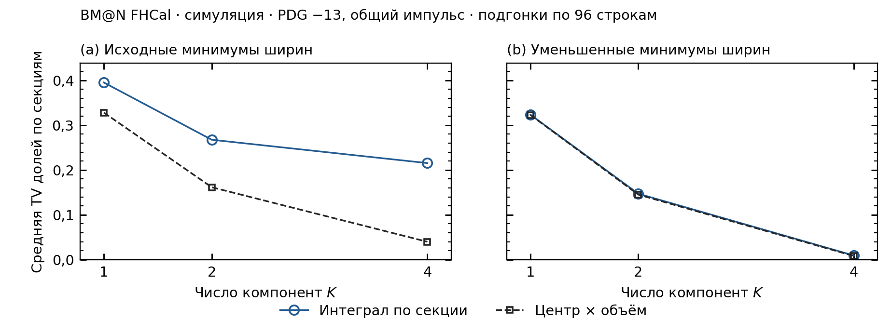
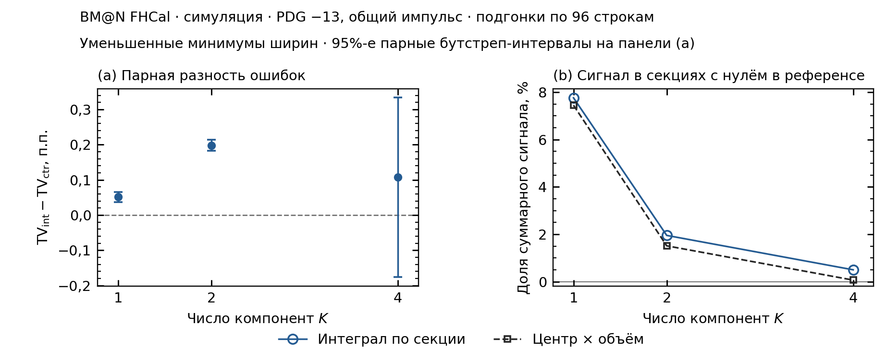
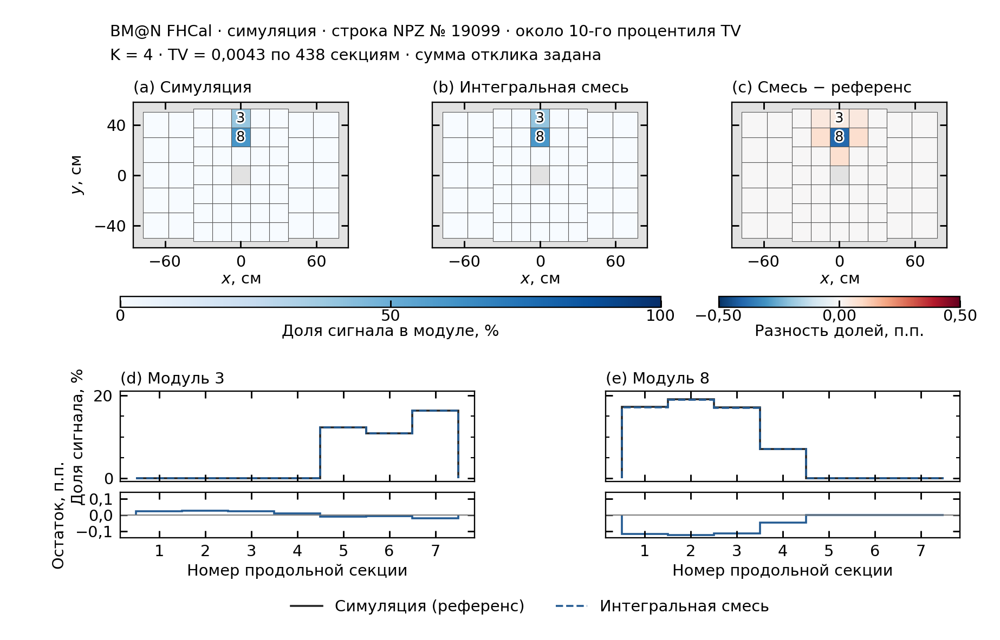
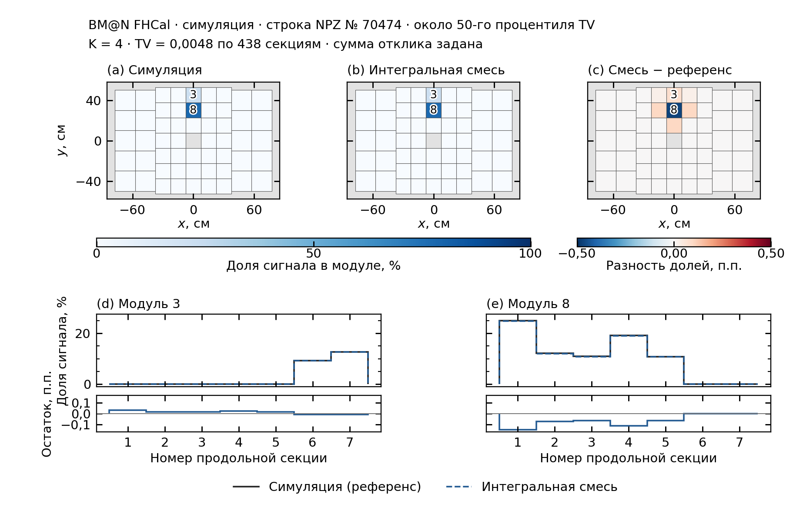
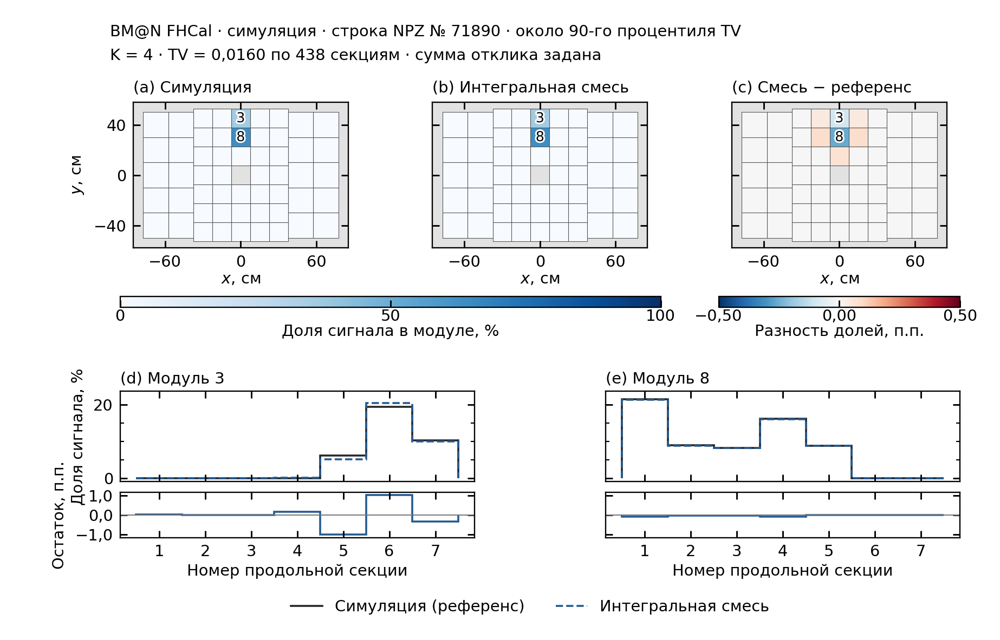
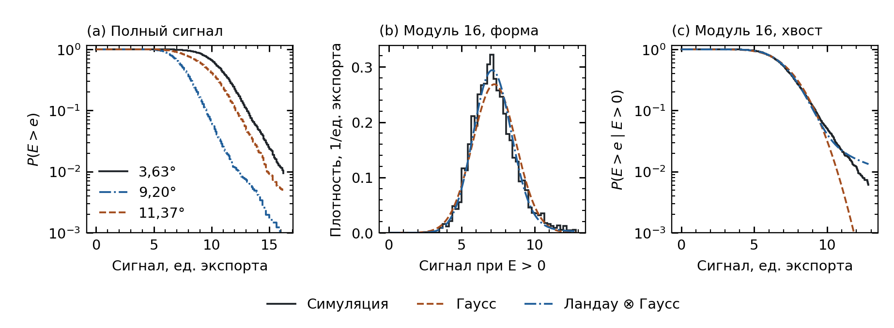

# Гауссовская смесь для секционного отклика FHCal

20 ноября 2026 года · BM@N FHCal · диагностический пилот.

## Идея

Отклик FHCal записан отдельными сигналами считываемых секций. Проверяем,
можно ли описать пространственную форму этого отклика несколькими
гауссовскими компонентами. Положение и ширины каждой компоненты задают
область сигнала поперёк и в глубину. Интегрирование плотности по
эффективному объёму секции переводит непрерывную смесь в отклик
на карте детектора.

Четырёхкомпонентная смесь задаёт приближение к 438 секционным долям
через 27 параметров формы. Такая модель может стать промежуточным представлением
для быстрой симуляции, если она достаточно точно сохраняет секционный
профиль. Этот пилот проверяет воспроизведение формы по наблюдённому
отклику при известной полной сумме сигнала.

## Постановка эксперимента

1. **Данные.** Используем 96 строк из симуляционного экспорта
   `fhcal_data_muons_81619.npz`. Они образуют две непересекающиеся
   группы по 48 строк с PDG −13 и одинаковым записанным импульсом.
   Вершины рождения различаются. Отклик сравниваем по 438 считываемым
   секциям. Карту секций, число первичных частиц и исходные идентификаторы
   предстоит сверить с ROOT.
2. **Сравнение.** Для каждой строки отдельно подгоняем смеси с 1, 2 и 4
   компонентами. Сравниваем интеграл плотности по секции с приближением
   «плотность в центре × объём». Нормируем каждую компоненту по считываемым
   секциям, поэтому её вес задаёт долю зарегистрированного сигнала.
   Оба варианта используют общие старты и минимизируют квадрат расстояния
   Хеллингера. Бюджет составляет три старта с лимитом 200 итераций каждый.
3. **Проверка.** С ростом числа компонент ожидаем меньшей ошибки.
   Метрика — расстояние полной вариации (англ. *total variation*, TV),
   половина суммы абсолютных разностей долей сигнала по секциям.
   Ширины в первом расчёте упирались в нижние границы, поэтому
   сравнение повторено на тех же строках с вдвое меньшими минимумами.
   Отдельно измеряем долю сигнала в секциях с наблюдаемым нулём.
   [Данные и постановка](README.md).

## При меньших минимальных ширинах ошибка подгонки снизилась

Рис. 1. Средняя TV относительно наблюдённых долей сигнала по секциям.
Нижние границы ширин уменьшены совместно с 5 до 2,5 см по обеим
поперечным осям и с 0,35 до 0,175 индекса секции по глубине. На панели
(b) кривые почти совпадают. Парная разность показана на рис. 2.
[Векторный рисунок](figures/tv_by_components.pdf).

Средняя TV по 96 строкам в долях суммарного сигнала. Меньше — точнее.

<!-- BEGIN CANONICAL TV TABLE -->

| $K$ | Интеграл, исходные | Центр × объём, исходные | Интеграл, уменьшенные | Центр × объём, уменьшенные |
| ---: | ---: | ---: | ---: | ---: |
| 1 | 0,3951 | 0,3280 | 0,3233 | 0,3228 |
| 2 | 0,2675 | 0,1616 | 0,1472 | 0,1452 |
| 4 | 0,2154 | 0,0399 | 0,0093 | 0,0082 |

<!-- END CANONICAL TV TABLE -->

У четырёхкомпонентной интегральной смеси средняя TV снизилась с
**0,2154 до 0,0093**. При уменьшенных границах TV составила 0,0100
и 0,0085 в двух группах. Все 96 интегральных
подгонок достигли хотя бы одной границы ширины. Оптимизатор сообщил об
успехе для 80 из 96 интегральных подгонок и 96 из 96 подгонок по
центрам. В сводку вошли лучшие конечные решения каждой подгонки при
установленном бюджете.

## При четырёх компонентах интервал парной разности TV включает ноль

Рис. 2. Уменьшенные границы ширин. Слева средняя парная разность TV
и 95%-е процентильные интервалы по 1 000 парным перевыборкам строк при
допущении их независимости. Систематика карты секций остаётся открытой.
Справа средняя по строкам доля полного сигнала, отнесённая к секциям с
наблюдаемым нулём.
[Векторный рисунок](figures/paired_tv_and_zero_signal.pdf).

Для четырёх компонент средняя парная разность «интеграл минус центр»
составила 0,0011 с 95%-м интервалом [−0,0018, 0,0033] в долях TV
(0,11 п.п. [−0,18, 0,33] на рисунке). Порог практической эквивалентности
не задан. Нулевой отклик наблюдался в 98,29 % секционных записей
референса. Средняя доля сигнала на этих адресах при четырёх компонентах
составила 0,50 % для интеграла и 0,07 % для контроля.

## Три подгонки с разной ошибкой

Среди 96 подгонок интегральной смеси с четырьмя компонентами и
уменьшенными границами выбраны строки с TV, ближайшей к 10-му,
50-му и 90-му процентилям. При равной близости берём меньший
индекс NPZ. Индексы отсчитываются от нуля. Полная сумма сигнала
во всех примерах задана наблюдением.
[Посекционные значения и правило отбора](example_events.json).

<!-- BEGIN CANONICAL EXAMPLES TABLE -->

| Процентиль TV | Строка NPZ | TV по секциям | Сигнал в нулевых секциях, % | Макс. отклонение секции, п.п. |
| ---: | ---: | ---: | ---: | ---: |
| 10-й | 19099 | 0,0043 | 0,43 | 0,12 |
| 50-й | 70474 | 0,0048 | 0,48 | 0,15 |
| 90-й | 71890 | 0,0160 | 0,58 | 1,02 |

<!-- END CANONICAL EXAMPLES TABLE -->

TV рассчитана по всем 438 секциям. Последний столбец показывает
максимальное абсолютное отклонение доли одной секции.
На рис. 3–5 поперечные карты отображают сумму по глубине и используют
общие шкалы. Серый фон обозначает пространство вне модулей. Продольные
панели показывают доли полного сигнала и остатки в модулях 3 и 8,
на которые во всех трёх строках приходится весь наблюдаемый сигнал.
Шкалы этих панелей подобраны для
каждой строки. Знак остатка везде задан как «смесь минус симуляция».

Рис. 3. Пример с малой ошибкой по секциям, около 10-го процентиля TV.
[Векторный рисунок](figures/example_event_q10.pdf).

Рис. 4. Пример около медианы TV. На модуль 8 приходится 78 % сигнала
симуляции. [Векторный рисунок](figures/example_event_projection.pdf).

Рис. 5. Пример около 90-го процентиля TV. После суммирования по
глубине TV по модулям составляет 0,0035, а TV по секциям — 0,0160.
В продольном профиле модуля 3 заметны отклонения разных знаков,
которые частично компенсируются при суммировании.
[Векторный рисунок](figures/example_event_q90.pdf).

## Вывод

Пилот показал чувствительность точности подгонки к нижним границам
ширины. Следующий эксперимент требует сверки геометрии и первичной
множественности по ROOT, раздельного изменения поперечных и продольных
границ и сравнения с разреженным кодом при сопоставимом размере
представления. [Протокол](../../docs/experiment_protocol.md).

## Воспроизводимость

Агрегаты и оценки отдельных строк читаются из
[исходного экспорта](pilot_results.json) и [проверки ширин](width_sensitivity.json).
[Реестр доказательств](evidence.json) фиксирует хеши, стадию оценки,
версию расчёта и карту. Таблица, рисунки и локальный HTML собираются
командой `make reproduce`. [Границы применимости](../../docs/experiment_state.md).

## Энергия мюонов в модулях

Суммировали сигналы по секциям каждого модуля и по всей карте.
В архиве PDG −13 три точных вектора с модулем импульса около 5 в
единицах экспорта. Их углы к записанной оси $+z$ составляют 3,63°,
9,20° и 11,37°. Взяли по 4 096 контрольных строк для каждого направления.
Медианы полного сигнала составили 10,65, 7,50 и 9,51 единицы экспорта.

**Рис. 6.** Слева дополняющие функции распределения полного сигнала
для трёх направлений. В центре и справа положительный отклик модуля 16
для угла 3,63° и две описательные подгонки. По горизонтали — сигнал в
единицах экспорта, по вертикали на крайних панелях — вероятность
превышения. Гистограмма нормирована на все положительные контрольные
строки, включая хвост за правой границей графика.

Модуль 16 выбран по частоте ненулевого сигнала на отдельных строках
подгонки. На контрольных строках $q_{10}$, $q_{50}$ и $q_{90}$ равны
**5,48**, **7,10** и **9,17**. Правый интервал $q_{90}-q_{50}$ (2,08)
шире левого $q_{50}-q_{10}$ (1,61). Свёртка Ландау и Гаусса снизила
отрицательную логарифмическую вероятность контрольных интервалов с
3,938 до 3,905 на строку. Парная разность равна −0,0327 с 95%-м
бутстреп-интервалом [−0,0444; −0,0212] из 1 000 перевыборок строк,
при фиксированных моделях и допущении независимости строк.

Ландау–Вавилов описывает асимметрию случайных ионизационных потерь
в слоях подходящей толщины. Свёртка с гауссом позволяет включить
гауссовское уширение. Здесь применена описательная подгонка
положительного сигнала всего модуля из архива. Для физической
проверки при нормальном падении нужны подтверждённые траектории,
активная толщина и параметры считывания.
[PDG, §34.2.9](https://pdg.lbl.gov/2024/reviews/rpp2024-rev-passage-particles-matter.pdf) ·
[Пример свёртки в ROOT](https://root.cern/doc/master/langaus_8C.html) ·
[Численный экспорт](energy_response.json).
