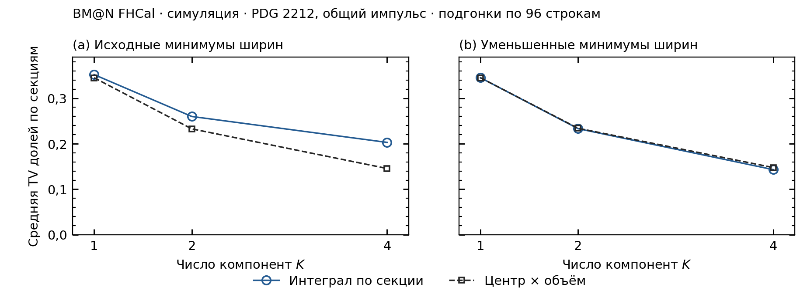
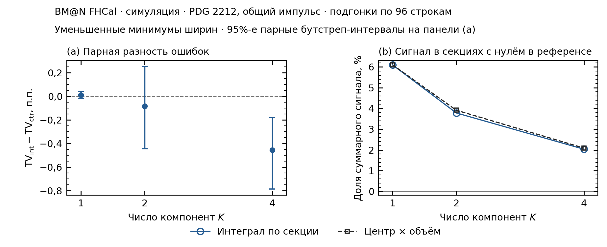
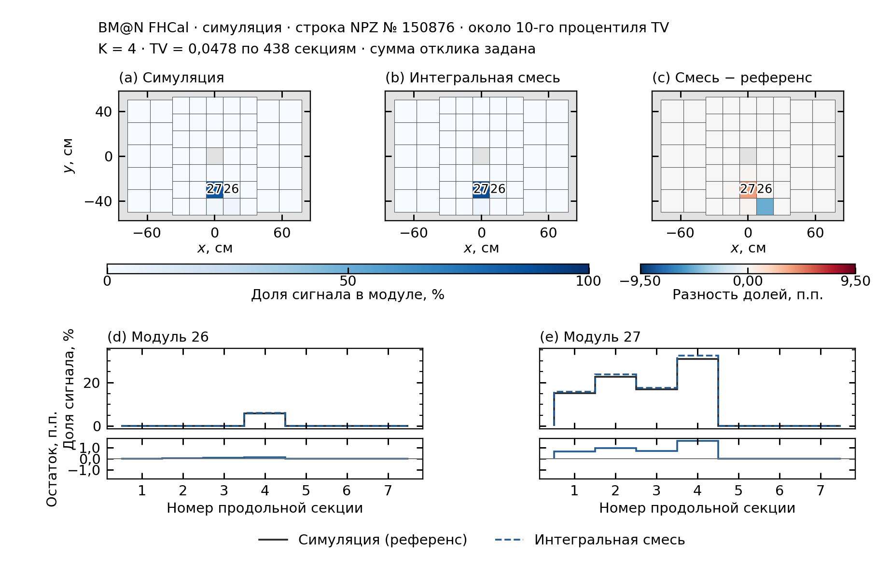
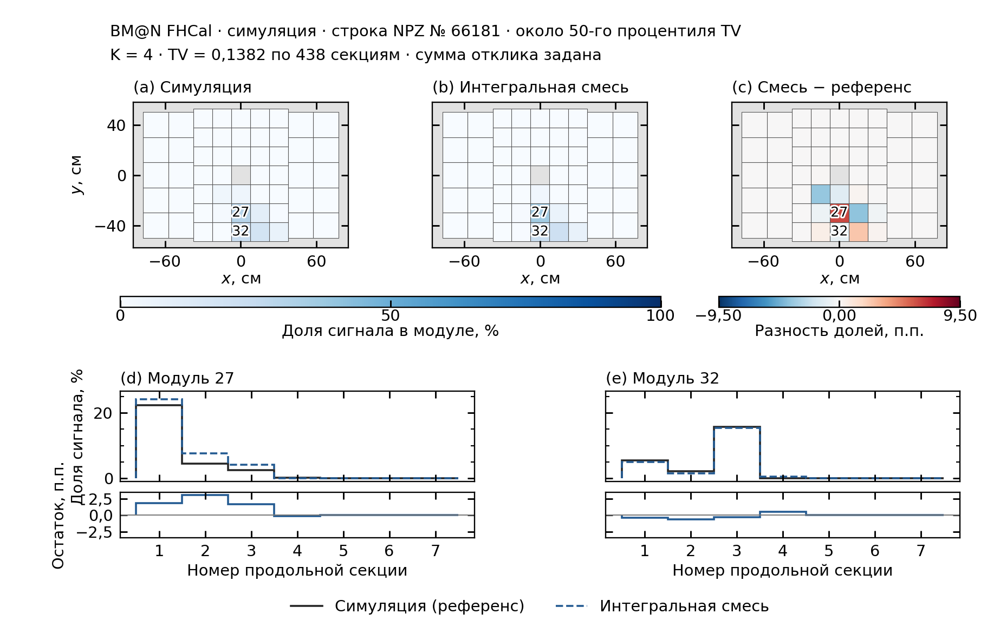
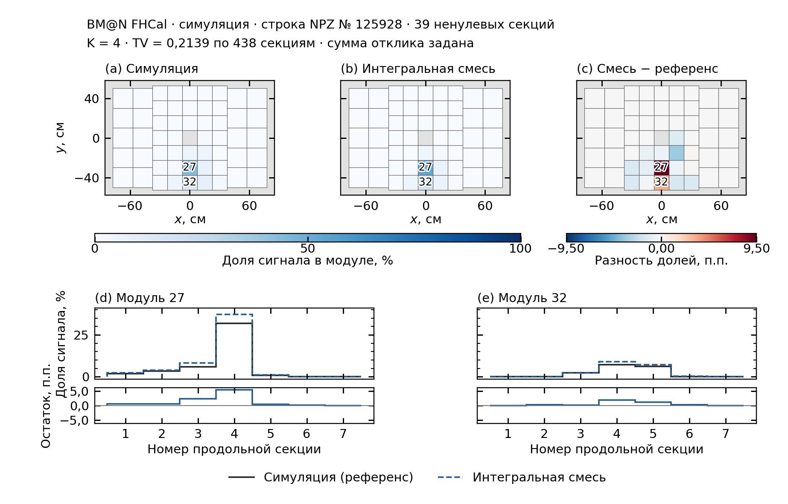
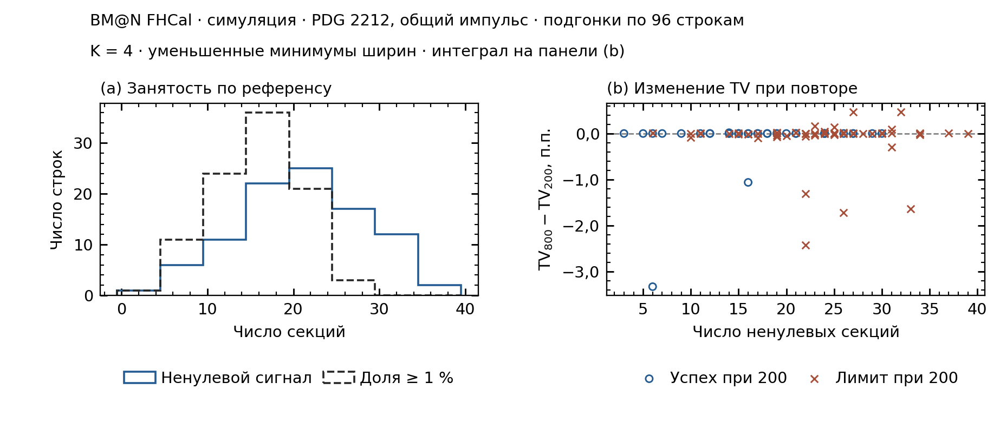
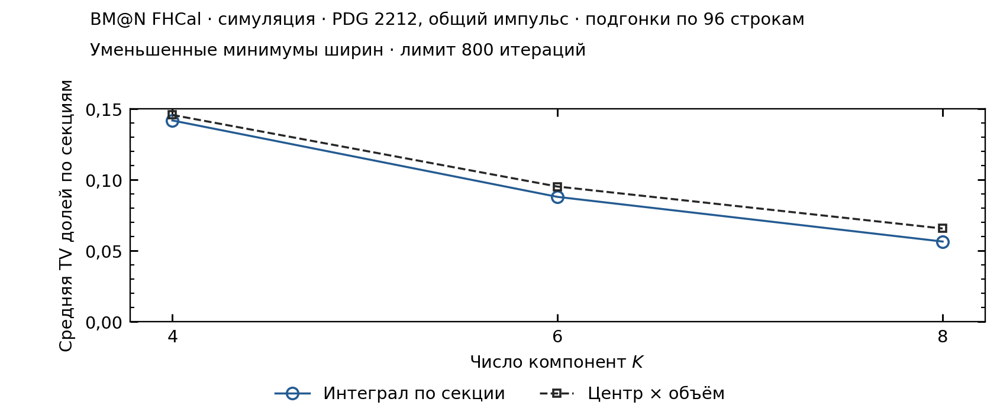
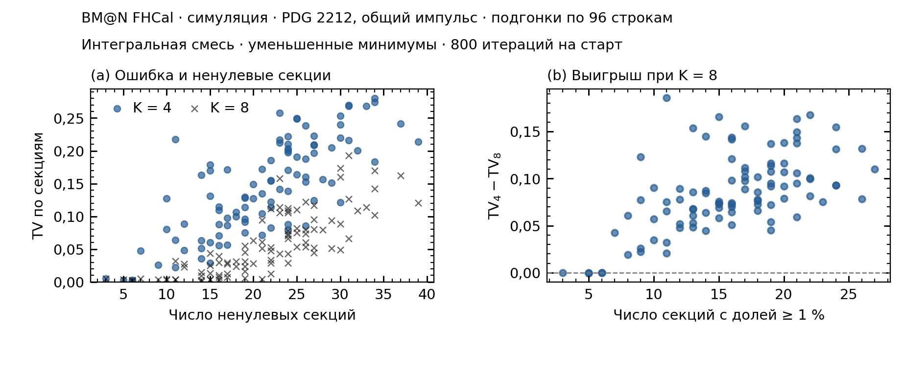
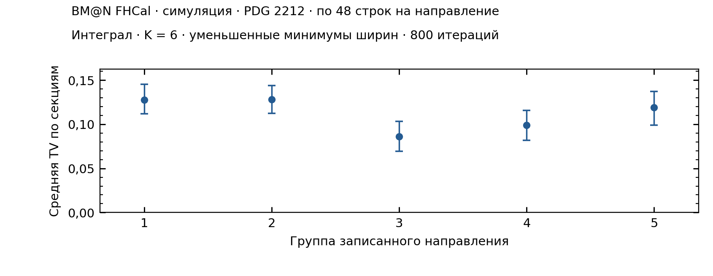
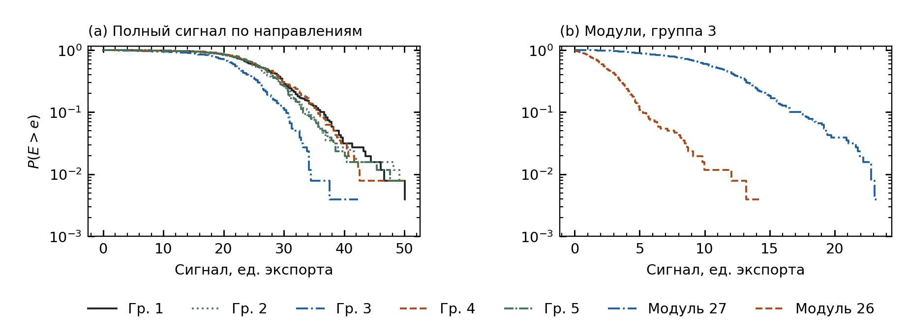

# Гауссовская смесь на протонном экспорте FHCal

20 ноября 2026 года · BM@N FHCal · диагностическая проверка.

## Идея и постановка

Проверяем, насколько хорошо пространственная смесь воспроизводит
форму секционного отклика на другом симуляционном экспорте.
Сравниваем интеграл плотности по секции с приближением
«плотность в центре × объём». Каждую строку подгоняем отдельно,
а суммарный сигнал берём из наблюдения.

Референс — `fhcal_data_side_modules81619_180.npz` из
`virtual_grid-gnn` на `2007441`. В файле 180 000 строк с
PDG 2212. Из 60 000 строк с выбранным общим вектором импульса
$(-0{,}1600,\;0{,}7307,\;4{,}9437)$ в единицах экспорта взяты две
непересекающиеся группы по 48 строк. Вершины рождения различаются.
Во всех 96 строках сумма по 438 секциям совпала с архивной, а вне
маски сигнал равен нулю. Физическую применимость карты, число первичных
частиц и исходные ID предстоит подтвердить по ROOT.
[Отбор и карта](../../../docs/experiment_protocol.md#проверка-переноса-на-протонном-экспорте).

Смеси с 1, 2 и 4 компонентами подгонялись по квадрату расстояния
Хеллингера. В каждом варианте использованы три одинаковых старта
с лимитом 200 итераций. Ошибку формы измеряем расстоянием полной
вариации (*total variation*, TV), половиной суммы абсолютных разностей
долей сигнала по секциям.

При увеличении числа компонент с 4 до 8 средняя TV снизилась с
0,1419 до 0,0566. Остаточная ошибка выше у строк с большим числом
ненулевых секций. [Отдельная проверка генерации по направлению частицы](conditional_baseline/RESULTS.md).

## При уменьшении минимумов ширин TV интегральной смеси снизилась

Рис. 1. Средняя TV на одних и тех же 96 строках. Нижние границы
изменены совместно с 5 до 2,5 см по обеим поперечным осям и с
0,35 до 0,175 индекса секции по глубине.
[Векторный рисунок](figures/tv_by_components.pdf).

Средняя TV в долях суммарного сигнала. Меньше — точнее.

<!-- BEGIN CANONICAL TV TABLE -->

| $K$ | Интеграл, исходные | Центр × объём, исходные | Интеграл, уменьшенные | Центр × объём, уменьшенные |
| ---: | ---: | ---: | ---: | ---: |
| 1 | 0,3521 | 0,3451 | 0,3452 | 0,3451 |
| 2 | 0,2600 | 0,2328 | 0,2332 | 0,2340 |
| 4 | 0,2030 | 0,1456 | 0,1430 | 0,1476 |

<!-- END CANONICAL TV TABLE -->

При четырёх компонентах средняя TV интегральной смеси снизилась
с **0,2030 до 0,1430**. С уменьшенными границами её лучшие решения
достигали хотя бы одной границы ширины во всех 96 строках.
В сводку входят все лучшие конечные решения при лимите 200 итераций.
Чувствительность к этому лимиту разобрана ниже.

## Знак разности TV зависит от настройки ширин

Рис. 2. Уменьшенные границы ширин. Слева средняя парная разность
«интеграл минус центр» и 95%-е процентильные интервалы по 1 000
парным перевыборкам строк при допущении их независимости. Справа
средняя доля полного сигнала в секциях с наблюдаемым нулём.
[Векторный рисунок](figures/paired_tv_and_zero_signal.pdf).

Для $K=4$ разность средних TV составила +0,0574 при исходных
границах и −0,0046 при уменьшенных. 95%-й парный интервал для
уменьшенных границ — [−0,0078, −0,0018]. Этот контраст относится
к выбранному бюджету и условен на корректность карты и
независимость строк. При уменьшенных границах интегральная смесь
отдала секциям с наблюдаемым нулём в среднем 2,03 % полного сигнала,
а приближение по центрам — 2,09 %.

## Три примера подгонки, включая максимальную занятость

Для интегральной смеси с четырьмя компонентами и уменьшенными
минимумами выбраны строки около 10-го и 50-го процентилей TV
и строка с наибольшим числом ненулевых секций среди 96 подгонок.
Индексы NPZ отсчитываются от нуля.
Карты показывают все модули, а продольные панели — по два модуля
с наибольшим наблюдаемым сигналом. Остаток задан как «смесь минус
симуляция». Шкалы карт общие, шкалы продольных панелей отдельные.
[Посекционный экспорт и правило отбора](example_events.json).

<!-- BEGIN CANONICAL EXAMPLES TABLE -->

| Критерий отбора | Строка NPZ | Ненулевые секции | TV по секциям | Сигнал в нулевых секциях, % | Макс. отклонение секции, п.п. |
| --- | ---: | ---: | ---: | ---: | ---: |
| 10-й процентиль TV | 150876 | 7 | 0,0478 | 0,49 | 4,78 |
| 50-й процентиль TV | 66181 | 22 | 0,1382 | 2,95 | 4,32 |
| Макс. занятость | 125928 | 39 | 0,2139 | 4,90 | 5,43 |

<!-- END CANONICAL EXAMPLES TABLE -->

Рис. 3. В модулях 26 и 27 сосредоточен 91,1 % наблюдаемого сигнала.
[Векторный рисунок](figures/example_event_q10.pdf).

Рис. 4. Показанные продольные профили модулей 27 и 32 охватывают
53,2 % наблюдаемого сигнала. Решение включено в сводку по
исходному бюджету и остановилось на 200 итерациях.
[Векторный рисунок](figures/example_event_projection.pdf).

Рис. 5. Строка № 125928 содержит 39 ненулевых секций в 14 модулях.
На модули 27 и 32 приходится 59,4 % наблюдаемого сигнала. TV по
модулям равна 0,1343, по всем секциям — 0,2139. Выбранная подгонка
остановилась на лимите 200 итераций.
[Векторный рисунок](figures/example_event_max_occupancy.pdf).

## Занятость и остановки оптимизатора

В 96 строках было от **3 до 39 ненулевых секций** из 438,
медиана 22, 90-й процентиль 30,5. В десяти строках ненулевыми
были 31 секция и более. При пороге 1 % полного сигнала на
секцию медиана равна 16, 90-й процентиль — 22, максимум — 27.
Это описывает занятость по наблюдаемому отклику.
В строке № 125928 с 39 ненулевыми секциями 24 давали не менее
1 % сигнала каждая. [Построчная диагностика](optimizer_diagnostics.json).

Рис. 6. Слева распределение числа секций в референсе при двух
определениях занятости. Справа изменение TV интегральной смеси
с четырьмя компонентами при переходе от 200 к 800 итерациям
на старт. Кресты отмечают остановки по лимиту в первом расчёте.
[Векторный рисунок](figures/occupancy_and_optimizer.pdf).

### Как учли остановки и что дал лимит 800

Оптимизатор выбирает из трёх стартов конечное решение с наименьшей
конечной потерей Хеллингера независимо от статуса остановки.
В исходном расчёте все выбранные решения без статуса успеха
достигли 200 итераций. Они сохранены в средних и в парном сравнении.

Для каждой строки таблицы четыре компоненты и 96 подгонок.

| Минимумы ширин | Оператор | Выбранный старт успешен | Выбранный старт достиг лимита | Из достигших лимита другой старт успешен | Ни одного успешного старта |
| --- | --- | ---: | ---: | ---: | ---: |
| Исходные | Интеграл | 59 | 37 | 24 | 13 |
| Исходные | Центр × объём | 26 | 70 | 24 | 46 |
| Уменьшенные | Интеграл | 37 | 59 | 28 | 31 |
| Уменьшенные | Центр × объём | 42 | 54 | 30 | 24 |

В режиме уменьшенных ширин средняя TV интегральной подгонки
составила 0,1106 при статусе успеха и 0,1634 при остановке по
лимиту. Для центра × объём — 0,1187 и 0,1701 соответственно.
Это описательные срезы. Отбор только успешных решений меняет
состав выборки и парное сравнение.

Повтор на тех же строках и стартах с лимитом 800 итераций дал
**96 из 96** успешных выбранных решений у обоих операторов.
Средняя TV интеграла изменилась с 0,1430 до 0,1419, контроля —
с 0,1476 до 0,1458. Средние потери Хеллингера снизились на
0,00052 и 0,00070 соответственно. Парная разность TV «интеграл
минус центр» составила −0,0039 с 95%-м интервалом
[−0,0075, −0,0003] при допущении независимости строк.
Среди строк с первоначальным статусом успеха более длинный расчёт
сменил выбранный старт в пяти интегральных подгонках и двух
подгонках по центрам.
В строке с 39 ненулевыми секциями оба оператора получили статус
успеха после увеличения бюджета. У интеграла TV осталась около 0,214.
[Экспорт стартов при 200 итерациях](restarts_200.json) ·
[при 800 итерациях](restarts_800.json).

### Фиксированное число компонент и процесс Дирихле

В этой серии $K$ задан в каждой подгонке. Такой контроль показывает,
как меняется ошибка при увеличении числа доступных компонент.
Смесь на процессе Дирихле допускает счётно бесконечное число
компонент. В усечённом вариационном приближении $K_{\max}$
задаёт вычислительный потолок, а существенный вклад могут давать
лишь несколько компонент. Для сравнения можно измерять
$K_{\mathrm{eff}}=1/\sum_k w_k^2$ и проверять устойчивость
результата к увеличению потолка.
[Blei и Jordan, §3.2](https://www.cs.columbia.edu/~blei/papers/BleiJordan2006.pdf).

## При увеличении числа компонент с 4 до 8 ошибка уменьшилась

После исходного пилота проверили $K=6$ и $K=8$ на тех же 96 строках
с уменьшенными минимумами ширин и лимитом 800 итераций на старт.
Число стартов и правила инициализации общие. Параметры стартов
зависят от $K$. Это поисковая оценка на строках подгонки.

Рис. 7. Средняя TV протонной подгонки при разных $K$ и одинаковом
лимите. Для каждого $K$ использованы все лучшие конечные решения.
[Векторный рисунок](figures/components_extended.pdf).

| Оператор | $K$ | Координаты формы | Средняя TV | Средние потери Хеллингера | Успех из 96 | Медиана итераций выбранного старта |
| --- | ---: | ---: | ---: | ---: | ---: | ---: |
| Интеграл | 4 | 27 | 0,1419 | 0,0589 | 96 | 252,5 |
| Интеграл | 6 | 41 | 0,0881 | 0,0355 | 96 | 414,5 |
| Интеграл | 8 | 55 | 0,0566 | 0,0227 | 82 | 517 |
| Центр × объём | 4 | 27 | 0,1458 | 0,0606 | 96 | 219 |
| Центр × объём | 6 | 41 | 0,0953 | 0,0381 | 91 | 334,5 |
| Центр × объём | 8 | 55 | 0,0658 | 0,0250 | 90 | 280,5 |

Для интеграла парная разность TV при $K=6$ относительно $K=4$
равна −0,0539 [−0,0603, −0,0472], при $K=8$ — −0,0853
[−0,0935, −0,0769]. Для центра × объём соответствующие разности
равны −0,0505 [−0,0569, −0,0441] и −0,0800 [−0,0880, −0,0717].
В скобках 95%-е процентильные интервалы по 1 000 парным
перевыборкам строк при допущении их независимости.
[Экспорт $K=6$](components_6.json) · [экспорт $K=8$](components_8.json).

Восемь компонент дали наименьшую среднюю TV среди проверенных.
При переходе с четырёх на восемь число координат формы выросло
с 27 до 55, а доля решений со статусом успеха уменьшилась.
Все выбранные решения без статуса успеха достигли 800 итераций.
Статус успеха означает выполнение численного критерия остановки.
Для выбора рабочего $K$ нужны отдельная выборка и оценка
качества при сопоставимой стоимости, включая разреженный код.

## Ошибка по событиям связана прежде всего с занятостью

На исходных 96 строках с одним записанным импульсом сравнили
интегральные подгонки с уменьшенными ширинами и лимитом 800.
Занятость и сумма измерены по референсу. Эффективное число
секций равно $1/\sum_i f_i^2$, где $f_i$ — доля сигнала.
Глубина задана локальным индексом секции.

Рис. 8. На панели (a) каждый маркер соответствует одной
подгонке на исходных 96 строках. На панели (b) положительная
разность означает меньшую TV у $K=8$. По всем строкам $K=8$
улучшил TV относительно $K=4$ в 94 случаях.
[Векторный рисунок](figures/event_dependence.pdf).

Средняя TV по срезам наблюдаемой занятости.

| Ненулевые секции | Строки | $K=4$ | $K=6$ | $K=8$ |
| --- | ---: | ---: | ---: | ---: |
| Меньше 31 | 86 | 0,1303 | 0,0786 | 0,0480 |
| 31 и больше | 10 | 0,2417 | 0,1697 | 0,1306 |

Ранговая корреляция Спирмена для 96 строк. Последний столбец —
связь признака с уменьшением TV при переходе от $K=4$ к $K=8$.

| Величина на строку | TV при $K=4$ | TV при $K=6$ | TV при $K=8$ | Выигрыш $4\to8$ |
| --- | ---: | ---: | ---: | ---: |
| Сумма сигнала | 0,23 | 0,34 | 0,32 | 0,13 |
| Ненулевые секции | 0,77 | 0,84 | 0,85 | 0,49 |
| Секции с долей ≥ 1 % | 0,82 | 0,84 | 0,83 | 0,58 |
| Эффективное число секций | 0,65 | 0,59 | 0,55 | 0,55 |
| Средняя глубина | 0,28 | 0,25 | 0,25 | 0,21 |
| Разброс по глубине | 0,36 | 0,27 | 0,32 | 0,21 |
| Вершина $x$ | 0,11 | 0,06 | −0,03 | 0,20 |
| Вершина $y$ | 0,07 | 0,04 | 0,06 | 0,02 |
| Вершина $z$ | 0,05 | 0,01 | 0,08 | −0,03 |

Это поисковые связи. Сумма и занятость меняются совместно.
Координаты относятся к записанной вершине в изученном диапазоне.
Для них вывод ограничен монотонными связями на данном срезе.
Условные интервалы по 1 000 перевыборкам строк и построчные
значения сохранены отдельно.
[Расчёт корреляций и срезов](event_dependence.json).

## Сравнение пяти записанных направлений

Для каждого направления взяли 48 строк с одним правилом
отбора и подгонки интегральной смеси с $K=6$. Для группы 3
использован первый отбор исходного пилота. Модуль записанного
импульса во всех группах около 5 в единицах экспорта.
Здесь меняется направление. Энергетического скана в архиве нет.

Рис. 9. Средняя TV в пяти группах. 95%-е интервалы рассчитаны
по 1 000 перевыборкам строк внутри группы при допущении их
независимости. В каждой группе 48 подгонок.
[Векторный рисунок](figures/momentum_groups.pdf).

Компоненты импульса округлены и приведены в единицах экспорта.

| Группа | $p_x$ | $p_y$ | $p_z$ | Строки в архиве | Средняя TV | Успех из 48 |
| ---: | ---: | ---: | ---: | ---: | ---: | ---: |
| 1 | −1,037 | 0,000 | 4,891 | 42 305 | 0,1280 | 45 |
| 2 | −1,028 | 0,000 | 4,893 | 17 606 | 0,1284 | 46 |
| 3 | −0,160 | 0,731 | 4,944 | 60 000 | 0,0862 | 48 |
| 4 | 0,437 | 0,000 | 4,981 | 17 695 | 0,0991 | 47 |
| 5 | 0,621 | 0,000 | 4,961 | 42 394 | 0,1191 | 48 |

Средняя ошибка зависит от выбранной архивной группы.
Сравнение включает различия записанных условий и происхождения
групп. Оно задаёт срезы для проверки генератора и оценку разброса
качества подгонки между этими срезами.
[Строки и интервалы по группам](event_dependence.json).

## Вывод для генеративного бейзлайна

1. **Добавление компонент дало больший выигрыш, чем увеличение лимита.**
   При уменьшенных ширинах переход $K=4\to8$ снизил среднюю TV
   интеграла на 0,0853. При $K=4$ увеличение лимита дало
   уменьшение на 0,0011, а разность операторов при большем
   лимите составила −0,0039.
2. **Отклик с большим числом ненулевых секций труднее подогнать.**
   Даже с восемью компонентами средняя TV составляет 0,1306
   в верхнем срезе занятости против 0,0480 в остальных строках.
   Этот срез нужен при проверке представления и генерации.
3. **Для прототипа генерации использован банк смесей с шестью компонентами.**
   Генератор выбирает смесь по одному из пяти записанных направлений.
   [Сравнение с выборкой целых откликов из того же банка](conditional_baseline/RESULTS.md).

Сравнение с мюонным архивом остаётся описательным из-за
различий входных условий. Оценки в этом отчёте относятся к
построчной подгонке на открытых откликах. [Мюонный пилот](../RESULTS.md).

## Воспроизводимость

[Основные результаты](pilot_results.json) ·
[уменьшенные границы](width_sensitivity.json) ·
[хеши и версии](evidence.json). Для локального HTML и рисунков
запустить `make proton-report` из корня репозитория.
Настройки повторного расчёта приведены в
[протоколе](../../../docs/experiment_protocol.md).

## Полный сигнал и отклик отдельных модулей

Дополнительная диагностика использует 1 280 контрольных строк протонного
генератора, по 256 на каждое из пяти направлений. Для модуля складываем
сигналы его секций, для полного сигнала складываем 54 модуля. В таблице
сравниваются средние в единицах экспорта. Банковский генератор берёт
полную сумму из случайной записи банка того же направления.

**Рис. 10.** Вероятность превышения уровня $e$ в симуляции. Слева полный
сигнал в пяти группах, справа сигнал модулей 27 и 26 в группе 3. Эти
модули чаще всего дают не менее 1 % полного сигнала на строках исходного
банка группы 3. Левая точка при $e=0$ показывает долю ненулевых откликов.
Крайние значения за пределами оси входят в расчёт вероятностей и квантилей.

| Группа | Средний полный сигнал симуляции | Средний полный сигнал банка | $W_1$ полного сигнала |
| ---: | ---: | ---: | ---: |
| 1 | 26,66 | 26,73 | 0,94 |
| 2 | 25,85 | 26,86 | 1,51 |
| 3 | 22,20 | 20,22 | 2,26 |
| 4 | 26,84 | 23,49 | 3,37 |
| 5 | 26,16 | 24,50 | 1,92 |

$W_1$ — расстояние Вассерштейна между контрольным распределением и
распределением банка. В построчной подгонке основного пилота полная
сумма задавалась наблюдением. Для свободной генерации дополнительно
сравниваются полная сумма, вероятность нуля и положительный хвост каждого
модуля. [Сравнение декодеров](conditional_baseline/DECODER_ANALYSIS.md) ·
[Показатели по всем модулям](../energy_response.json).
