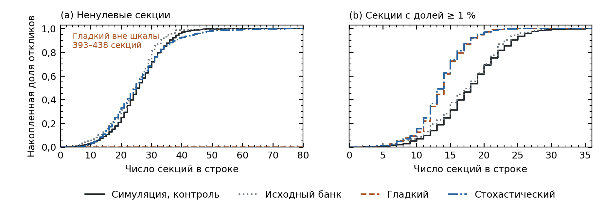
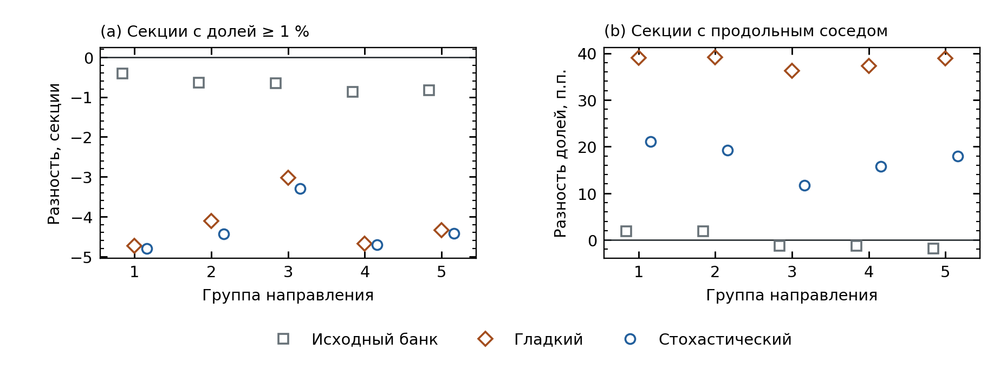
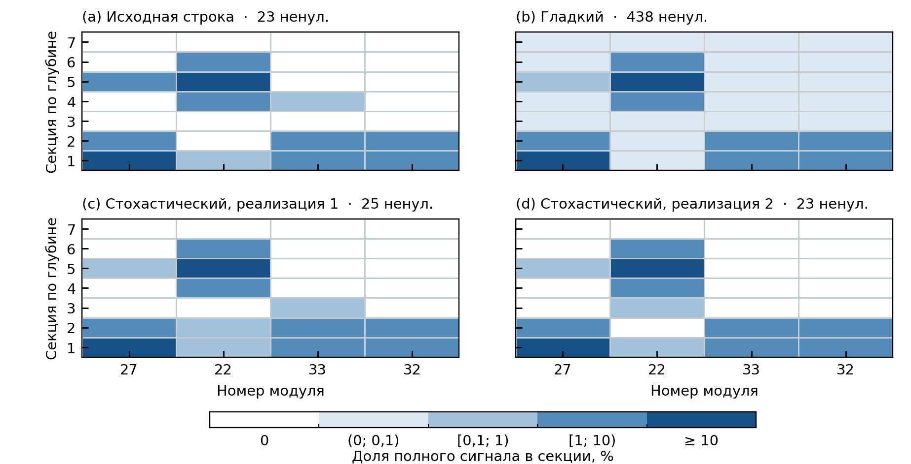
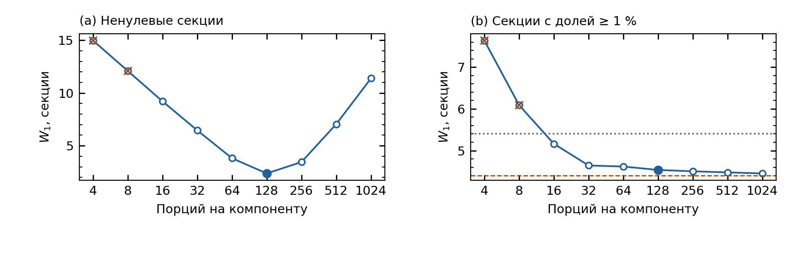
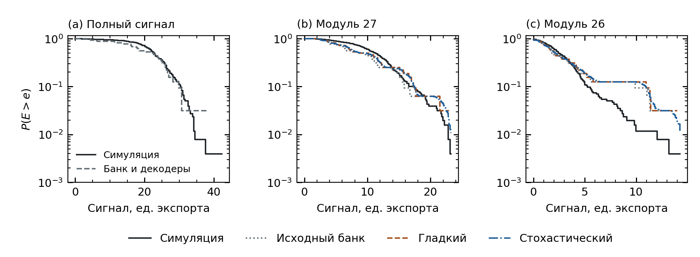
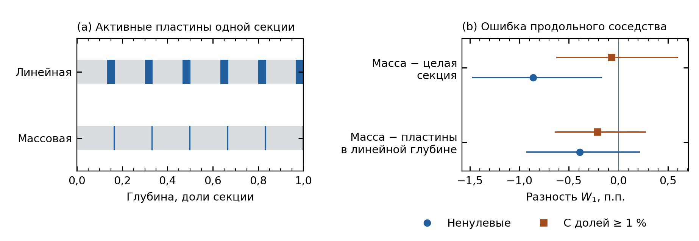

# Стохастическое декодирование протонного отклика FHCal

20 ноября 2026 года · BM@N FHCal · анализ фиксированного банка смесей

## Декодер возвращает разреженность отклика

Среднее число ненулевых секций составляет **25,66** у стохастического
декодера и **25,74** в симуляции. У гладкого декодера их 432,32. При пороге
1 % от полного сигнала строки обе версии дают в среднем около 14 секций
вместо 18. Основной спад виден при переходе от исходных откликов банка
к гладким смесям.

Референс для сравнения — **1 280 контрольных строк** архива PDG 2212,
по 256 на каждое из пяти записанных направлений. Отдельный банк
содержит по 32 строки на направление. Гладкий вариант интегрирует
смесь из шести компонент по 438 секциям. Стохастический вариант
разыгрывает 128 равноэнергетических порций внутри каждой компоненты,
по 32 реализации на запись. Три варианта используют одни и те же записи
банка, веса выбора и суммы. Этот анализ повторно использует контрольное
разбиение. Настройки зафиксированы до анализа.

**Рис. 1.** Накопленные распределения числа секций, направления имеют
равные веса. Слева показан диапазон симуляции, исходного банка и
стохастического декодера. У гладкого варианта от 393 до 438 ненулевых
секций. Справа оба декодера смещены к меньшей занятости.

| Среднее по строкам | Симуляция | Исходный банк | Гладкий | Стохастический |
| ----------------------------- | ---------: | ------------: | --------: | --------------: |
| Ненулевые секции | 25,74 | 23,94 | 432,32 | 25,66 |
| Секции с долей ≥ 1 % | 17,94 | 17,26 | 13,76 | 13,61 |
| Ненулевые секции с долей < 1 % | 7,80 | 6,69 | 418,56 | 12,05 |
| Сумма слабого сигнала, % от полного | 3,99 | 3,38 | 3,84 | 3,68 |

Большинство срабатываний гладкого декодера несут очень малые доли
сигнала. Розыгрыш порций собирает слабый сигнал в меньшее число секций,
сохраняя общий сигнал каждой записи. Близкое общее число секций у
стохастического декодера складывается из избытка слабых и дефицита
заметных срабатываний.

## Продольное соседство избыточно во всех направлениях

Измеряем долю занятых секций, у которых сработала хотя бы одна из двух
соседних по глубине секций того же модуля. При учёте всех ненулевых секций
средняя доля составляет **61,86 %** в симуляции, **61,72 %** у исходного
банка, **100,00 %** у гладкого и **78,99 %** у стохастического декодера.
При пороге 1 % учитываем только прошедшие его секции. Доли
с продольным соседом равны **56,17 %, 57,13 %, 67,49 % и 66,47 %**.

**Рис. 2.** Среднее по варианту минус среднее симуляции для каждого из
пяти направлений. Продольное соседство справа рассчитано по ненулевым
секциям. В каждом направлении у стохастического декодера заметных
секций слишком мало, а продольных соседств слишком много.

Измеряем $W_1$, расстояние Вассерштейна до распределения симуляции,
и усредняем его по направлениям. Для числа секций с долей от 1 % оно
равно **1,02** у исходного банка, **4,22** у гладкого декодера и
**4,37** у стохастического. Переход к гладкой смеси добавляет **3,19**
секции ошибки с 95%-м интервалом [2,25; 3,21]. Розыгрыш порций добавляет
ещё **0,15** [0,03; 0,24]. По доле секций с продольным соседом переход
от гладкого к стохастическому снижает $W_1$ с **38,14** до **17,16 п.п.**
Парный контраст равен **−20,98 п.п.** [−22,49; −19,49]. У исходного
банка на той же метрике $W_1$ равно **2,51 п.п.**

Интервалы получены из 1 000 парных перевыборок записей банка и
контрольных строк внутри направлений при допущении независимости строк.
Реализации одной записи перевыбирались вместе. Интервалы относятся
к фиксированному набору реализаций. Соседство измерено
только вдоль одного модуля. Исходные идентификаторы событий и физическое
соответствие карты остаются неподтверждёнными по ROOT.

## Что меняется в одной реализации

**Рис. 3.** Строка банка № 45739 (направление 3), выбранная по близости
к медианной занятости при пороге 1 %. Показаны четыре модуля с наибольшим
исходным сигналом. Число ненулевых секций в заголовках относится ко всей
карте. Гладкая форма и две реализации используют одну и ту же смесь
и сумму. Белый цвет означает точный ноль.

**Рис. 4.** Выбор на 640 калибровочных строках. Закрашенный маркер
показывает 128 порций на компоненту. Крестами отмечены варианты,
превысившие хотя бы один инженерный допуск. Справа штрихи отмечают
$W_1$ гладкого декодера, точки — допуск на ухудшение на одну секцию.

Режим подходит как контроль разреженности. Следующая проверка для
дефицита заметных секций — сравнить банки с разным числом компонент
на тех же строках. Продольное соседство требует отдельной метрики
при выборе декодера.

[Числа и данные рисунков](decoder_analysis.json) ·
[Калибровка и контрольные строки](stochastic_decoder.json) ·
[Команды генерации](RESULTS.md#запустить-генерацию) ·
[Протокол](../../../../docs/experiment_protocol.md#диагностика-распределения-сигнала-по-секциям)

## Полный сигнал и правый хвост модуля

Для каждого из пяти направлений сравнили распределения полного сигнала
и сумм по секциям каждого модуля на тех же 1 280 контрольных строках.
Полная сумма сохраняется при обоих способах декодирования. Среднее по
направлениям расстояние Вассерштейна $W_1$ до симуляции равно **2,00**
единицы экспорта у исходного банка и обоих декодеров. Различие с симуляцией
здесь определяется распределением сумм в банке.

**Рис. 5.** Вероятность превышения $e$ для группы 3, 256 контрольных
строк. Два модуля выбраны по частоте доли сигнала от 1 % на исходных
строках банка. При $e=0$ видна вероятность ненулевого отклика. Правые
границы ограничивают рисунок. Все строки входят в численные оценки.

| Модуль 26, группа 3 | Симуляция | Исходный банк | Гладкий | Стохастический |
| ----------------- | ---------: | ------------: | --------: | --------------: |
| Точный ноль, % | 3,13 | 6,25 | 0,00 | 4,30 |
| $q_{10}$ при $E>0$, ед. экспорта | 0,75 | 0,77 | 0,49 | 0,58 |
| Медиана при $E>0$, ед. экспорта | 2,52 | 1,96 | 2,02 | 2,18 |
| $q_{90}$ при $E>0$, ед. экспорта | 5,32 | 9,96 | 10,39 | 10,94 |

У модуля 26 стохастический декодер возвращает ненулевую вероятность
точного нуля. Правый хвост завышен уже в исходном банке. В модуле 27
у стохастического декодера медиана 9,03 против 11,22 в симуляции, а
$q_{90}$ близки (17,34 и 16,97). Декодер сохраняет полную сумму
записи и приближает общую занятость. При оценке
генератора отдельно нужны вероятность нуля, медиана и правый хвост
положительного сигнала в каждом направлении.

[Полный экспорт по модулям и направлениям](../../energy_response.json) ·
[Мюонная проверка Ландау–Гаусса](../../RESULTS.md#энергия-мюонов-в-модулях).

## Вес поглотителя в продольной координате

В опубликованной конструкции секция считывает шесть сцинтилляционных
пластин. В проверочной укладке чередуются 16 мм свинца и 4 мм
полистирола. При плотностях 11,35 и 1,06 г/см³ вклад одного слоя в
массовую глубину равен 18,16 и 0,424 г/см² соответственно. Поэтому
свинец задаёт большую часть расстояния между активными пластинами
в координате $t=\int\rho(z)\,dz$. Видимый сигнал интегрируется по
шести активным интервалам. Использована повторяющаяся укладка
Pb–сцинтиллятор по опубликованным размерам. Начальный порядок,
торцевые слои и геометрия архива требуют сверки по ROOT. Меняются
координата и активные интервалы декодера при подгонке к тому же
отклику. Физический эффект смены материала требует отдельного
транспортного расчёта.

**Рис. 6.** Синим показаны активные интервалы, серым — поглотитель.
Обе координаты приведены к единичной толщине секции. Справа разность
$W_1$ массовой глубины и двух контролей. Отрицательное значение
соответствует меньшей ошибке. Интервалы условны на независимость строк
и фиксированные реализации.

| Интеграл | $W_1$ соседства, ненулевые секции, п.п. | $W_1$ соседства, доля ≥ 1 %, п.п. |
| --- | ---: | ---: |
| По целой секции | 17,16 | 10,44 |
| По пластинам в линейной глубине | 16,69 | 10,58 |
| По пластинам в массовой глубине | 16,30 | 10,37 |

Два варианта по пластинам подогнали на тех же 160 строках с шестью
компонентами. Проверили на тех же 1 280 контрольных строках при
128 порциях. При учёте всех ненулевых секций изменение относительно
целой секции равно −0,86 п.п. [−1,48; −0,17]. Улучшение меньше
инженерного порога 2 п.п. Разность между массовой и линейной глубиной
при интегрировании по пластинам равна −0,39 п.п. [−0,93; +0,22].
Массовая глубина оставляет избыток соседства: 78,13 % против 61,86 %
в симуляции. Вариант сохранён для проверок материала, рабочий декодер
использует прежнюю калибровку. Интервалы рассчитаны по 1 000 парных
перевыборок строк банка и контроля внутри направлений. Все 32
реализации одной записи банка перевыбирались вместе. Лимита 800
итераций достигли 11 из 160 подгонок в линейной глубине и 6 из 160
в массовой. Их конечные решения вошли в сравнение.

[Числа, настройки и интервалы](layered_projection.json) ·
[Конструкция FHCal, §8.1](https://indico.jinr.ru/event/5012/attachments/20875/36353/%D0%A1%D0%B5%D0%B4%D1%8B%D1%85_The-BMN-spectrometer_2024_NIM.pdf) ·
[Плотность Pb](https://pdgweb.lbl.gov/2024/AtomicNuclearProperties/HTML/lead_Pb.html) ·
[Плотность полистирола](https://physics.nist.gov/PhysRefData/XrayMassCoef/tab2.html).
